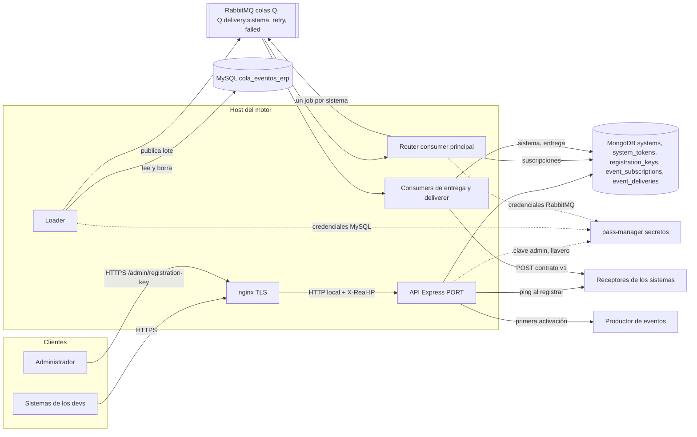
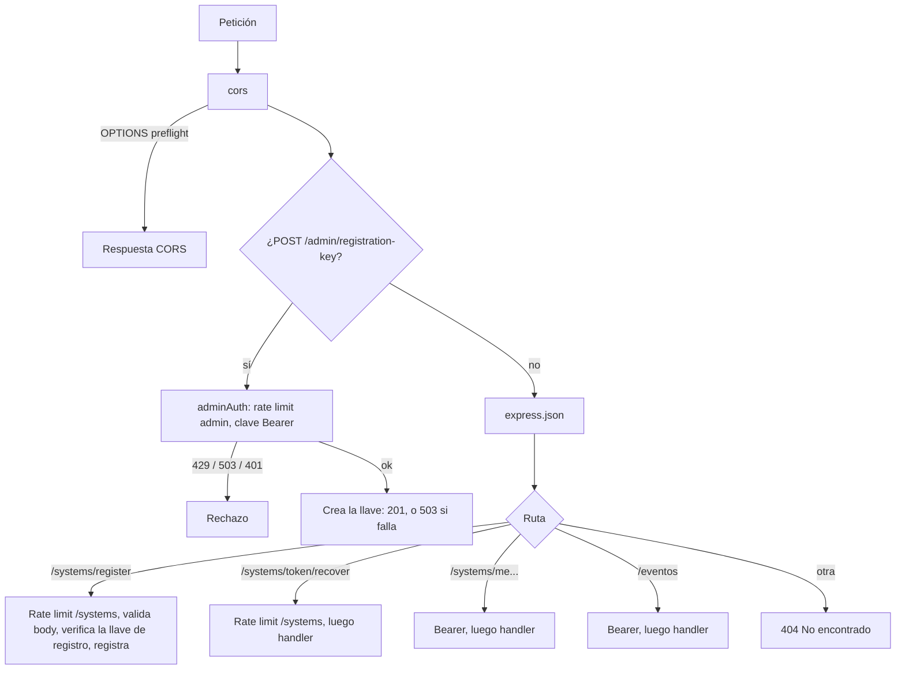
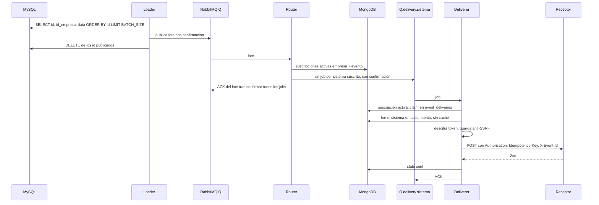
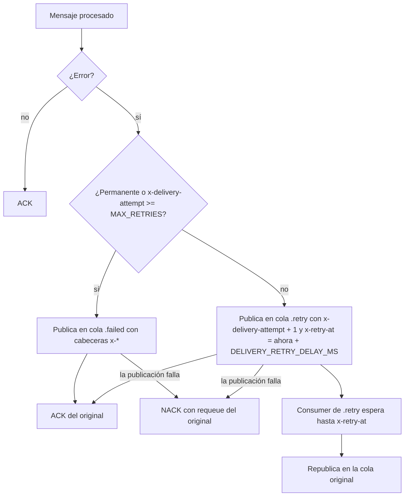
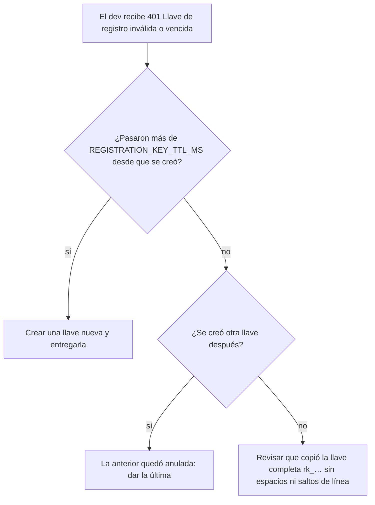
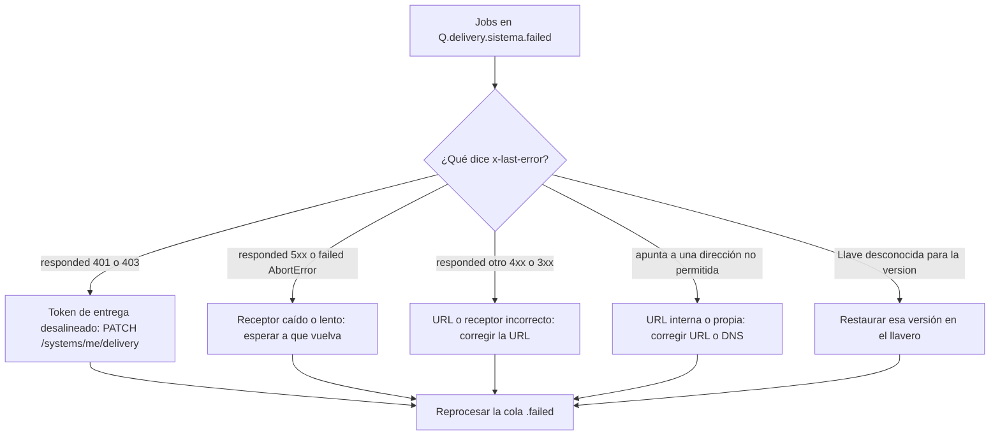
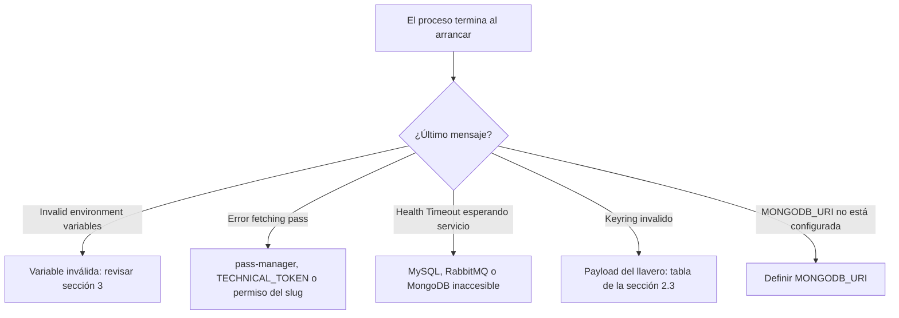

# Guía del administrador de cuenti-event-engine

> Guía de operación y administración del motor de eventos. Cubre lo que hace quien lo corre en producción y decide quién puede usarlo: llave de registro, clave de administrador, credenciales iniciales de los sistemas, secretos, despliegue, colas y respuesta a incidentes.
>
> Fuente de verdad: el código del repositorio. Cada dato de esta guía (rutas, cabeceras, códigos, mensajes, variables, scripts, colecciones, colas y tiempos) se comprobó contra `src/`. Lo que no se pudo comprobar en el código se marca como **no verificado**.

## Índice

- [0. Portada](#0-portada)
- [1. Modelo mental y arquitectura](#1-modelo-mental-y-arquitectura)
- [2. Secretos en pass-manager](#2-secretos-en-pass-manager)
- [3. Configuración](#3-configuración)
- [4. Perímetro y red](#4-perímetro-y-red)
- [5. Llave de registro](#5-llave-de-registro)
- [6. Gestión de sistemas y credenciales](#6-gestión-de-sistemas-y-credenciales)
- [7. Scripts y herramientas](#7-scripts-y-herramientas)
- [8. Operación diaria](#8-operación-diaria)
- [9. Runbooks](#9-runbooks)
- [10. Seguridad](#10-seguridad)
- [11. Troubleshooting](#11-troubleshooting)
- [12. Apéndices](#12-apéndices)
- [Cierre: cómo reportar un incidente](#cierre-cómo-reportar-un-incidente)

---

## 0. Portada

### 0.1 Para quién es

Para la persona que **opera** el motor (lo despliega, lo arranca, lo vigila y lo recupera) y que **administra el acceso** (quién puede registrar sistemas mediante la llave de registro, cuál es la clave de administrador, qué credenciales iniciales tienen los sistemas). Se asume que conocés Linux, MongoDB (`mongosh`), RabbitMQ y nginx. No se asume que recuerdes los detalles internos del motor: esta guía los explica.

Documentos relacionados (para otros públicos):

| Documento | Público | Contenido |
|---|---|---|
| [README.md](../README.md) | Operador / dev del motor (inglés) | Modelo de procesamiento, variables, runbooks de corte de fase 1 y 2. |
| [docs/guia-desarrollador.md](guia-desarrollador.md) | Dev de un sistema consumidor | Guía completa de integración: registro, tokens, suscripciones (`/eventos`), recepción de entregas y errores. |
| [docs/contrato-entregas-v1.md](contrato-entregas-v1.md) | Dev de un sistema receptor | Contrato de entrega, ping, registro y rotación de tokens. |

### 0.2 Alcance: qué administra el administrador y qué no

El motor es **autoservicio** para los desarrolladores: cada dev registra su sistema, obtiene y rota su token de acceso, cambia su URL o su token de entrega y gestiona sus suscripciones **por API**, sin intervención del administrador. El administrador gestiona el perímetro y la infraestructura.

| Lo gestiona el administrador | Lo gestiona cada dev por API (no el administrador) |
|---|---|
| Llave de registro (`POST /admin/registration-key`). | Alta de su sistema (`POST /systems/register`). |
| Clave de administrador (pass-manager). | Token de acceso: rotación (`POST /systems/me/tokens`) y recuperación (`POST /systems/token/recover`). |
| Credenciales iniciales de sistemas preexistentes (`migrate:system-credentials`). | URL y token de entrega (`PATCH /systems/me/delivery`). |
| Secretos en pass-manager (MySQL, RabbitMQ, llavero de cifrado, clave admin). | Suscripciones (`POST /eventos`, `PATCH /eventos/estado`, `GET /eventos`). |
| Variables de entorno, despliegue, pm2, nginx, TLS, firewall. | Su receptor: responder al contrato v1 e idempotencia. |
| Colas de RabbitMQ (`.retry`, `.failed`) y reprocesos. | |
| Revocar o reactivar un sistema (solo en Mongo; no hay endpoint). | |
| Respuesta a incidentes, backups, rotaciones periódicas. | |

No existe ningún endpoint de administración para crear, borrar o revocar sistemas, ni para ver o tocar suscripciones de terceros: esas operaciones, cuando hacen falta, se hacen con los scripts o directamente en Mongo (ver [sección 6](#6-gestión-de-sistemas-y-credenciales)).

### 0.3 Resumen de responsabilidades

| Área | Tarea | Frecuencia | Sección |
|---|---|---|---|
| Acceso | Crear la llave de registro / cortar el registro | A demanda | [5](#5-llave-de-registro), [9.3](#93-c-crear-o-revocar-la-llave-de-registro) |
| Secretos | Rotar la clave de administrador | Periódica / incidente | [9.4](#94-d-rotar-la-clave-de-administrador) |
| Secretos | Rotar el llavero de cifrado | Periódica / incidente | [9.5](#95-e-rotar-el-llavero-de-cifrado) |
| Sistemas | Emitir credenciales a sistemas preexistentes | Corte / excepcional | [6.4](#64-credenciales-iniciales-migratesystem-credentials) |
| Sistemas | Revocar un sistema comprometido | Incidente | [9.7](#97-g-sistema-comprometido-o-abusivo) |
| Colas | Vigilar y reprocesar `.failed` | Diaria | [8.6](#86-reproceso-de-las-colas-failed) |
| Infraestructura | Desplegar, reiniciar, revertir | A demanda | [9.1](#91-a-puesta-en-producción-y-corte-desde-la-versión-anterior), [9.13](#913-m-restaurar-tras-un-despliegue-fallido) |
| Infraestructura | Backups de Mongo y del llavero | Diaria / semanal | [8.7](#87-backups) |

### 0.4 Convenciones

| Convención | Significado |
|---|---|
| `https://engine.example.com` | URL pública del motor (detrás de nginx con TLS). Reemplazala por la real. |
| `<ADMIN_KEY>` | Clave de administrador (payload `key` del slug `SLUG_ADMIN_API_KEY`). |
| `cev_xxxxxxxx…` | Token de acceso de un sistema (`cev_` + 43 caracteres base64url). |
| `<PORT>` | Valor de la variable `PORT` (puerto local en el que escucha el motor). |
| `"$MONGODB_URI"` | Cadena de conexión a Mongo (la misma que usa el motor). No la pegues en tickets. |
| `192.0.2.0/24`, `203.0.113.0/24`, `198.51.100.0/24`, `2001:db8::/32` | Rangos de documentación (RFC 5737 / RFC 3849) usados en los ejemplos. |
| `<Q>` | Nombre de la cola principal (`RABBIT_QUEUE_NAME`, por defecto `erp.events.batch`, o `rabbit_queue_name` del secreto de RabbitMQ; ver [1.4](#14-colas-de-rabbitmq)). |

**`pnpm …` frente a `node dist/…`.** Los scripts `migrate:*` de `package.json` usan `tsx` (dependencia de desarrollo). En un host instalado con `pnpm install --prod` no hay `tsx`: usá la forma compilada `node dist/scripts/<nombre>.script.js`, que existe después de `pnpm build`. Ambas formas hacen exactamente lo mismo. Ejecutá siempre los scripts **desde el directorio del proyecto**: leen `.env` del directorio actual.

| `pnpm` (desarrollo / host con devDependencies) | Compilado (host `--prod`) |
|---|---|
| `pnpm migrate:systems <manifest.json> [--skip-ping]` | `node dist/scripts/migrateSystems.script.js <manifest.json> [--skip-ping]` |
| `pnpm migrate:delivery-jobs` | `node dist/scripts/migrateDeliveryJobs.script.js` |
| `pnpm migrate:system-credentials <name>... [--force]` | `node dist/scripts/migrateSystemCredentials.script.js <name>... [--force]` |
| `pnpm migrate:subscriptions <manifest.json>` | `node dist/scripts/importSubscriptions.script.js <manifest.json>` |

Los mensajes del motor se citan **textualmente**, incluidos los que no llevan tilde (por ejemplo `Keyring invalido`).

---

## 1. Modelo mental y arquitectura

### 1.1 Qué hace el motor en una frase

Lee eventos pendientes de una tabla MySQL, los publica en lotes en RabbitMQ, decide con las suscripciones de MongoDB a qué sistemas destino va cada evento y entrega cada evento a cada sistema con un `POST` (contrato v1), con reintentos y cola de fallidos **por sistema**. Además expone un API HTTP para que los sistemas se registren, gestionen sus tokens y sus suscripciones, y un API de administración para crear la llave de registro.

### 1.2 Componentes

| Componente | Rol | Qué pasa si falta |
|---|---|---|
| **API Express** (`src/app.ts`, `src/app.factory.ts`) | `/admin/registration-key`, `/systems/*`, `/eventos`. Escucha en `PORT` en **todas las interfaces** (`app.listen(Env.PORT)` sin host). | — |
| **Loader** (`src/services/messageLoader/`) | Cada `POLL_INTERVAL_MS` lee hasta `BATCH_SIZE` filas de `log_transacciones.cola_eventos_erp` (orden por `id`), publica el lote en `<Q>` con confirmación y solo entonces borra esos `id` en trozos de `DELETE_CHUNK_SIZE`. Se apaga con `RUN_LOADER=false`. | Las filas quedan en MySQL; nada se pierde. |
| **Consumer principal / router** (`src/services/messageConsumer/`) | Consume `<Q>`, valida cada evento, busca suscripciones activas en Mongo y publica **un job por sistema suscrito** en `<Q>.delivery.<sistema>`. Nunca hace HTTP. Se apaga con `RUN_CONSUMER=false`. | Los lotes esperan en `<Q>`. |
| **Consumers de entrega + deliverer** (`src/services/orchestrator/deliverer.service.ts`) | Un consumer por sistema de la colección `systems` (cualquier estado). Por cada job: comprueba la suscripción, reclama la entrega en `event_deliveries`, descifra el token, aplica la guarda anti-SSRF y hace el `POST`. | Los jobs esperan en su cola. |
| **MySQL** | Origen de eventos (tabla `log_transacciones.cola_eventos_erp`). Credenciales en el slug `SLUG_DATABASE`. | Arranque abortado; en marcha, el loader reintenta. |
| **MongoDB** | Sistemas, tokens, llave de registro, suscripciones, estado de entregas. `MONGODB_URI`. | Ver [9.10](#910-j-mongo-caído). |
| **RabbitMQ** | Colas principal, de entrega, `.retry` y `.failed`. Credenciales en el slug `SLUG_QUEUE_CONNECTOR`. vhost siempre `/`. | Ver [9.11](#911-k-rabbitmq-caído-o-cola-creciendo). |
| **pass-manager** (`src/utils/passManager.client.ts`) | Servicio de secretos: credenciales MySQL y RabbitMQ, llavero de cifrado, clave admin. Se accede con `BASE_URL`, `TECHNICAL_TOKEN`, `ENVIRONMENT_CODE`. | Ver [9.9](#99-i-pass-manager-caído-o-permiso-faltante). |
| **nginx** (externo al repo) | Termina TLS, limita el tamaño del body y reenvía al puerto local fijando `X-Real-IP`. | Sin TLS, contraseñas y tokens viajan en claro. |
| **Productor** (externo) | `EVENT_PRODUCER_ENABLE_URL` / `EVENT_PRODUCER_KEY`: la primera suscripción de una empresa+evento pide al productor que genere ese evento. | La primera activación de una empresa+evento responde `503`. |

### 1.3 Colecciones de MongoDB

El motor usa la base de datos de la URI (`client.db()` sin nombre: la base que indique `MONGODB_URI`). Los índices se crean **al conectar** cada proceso (motor y scripts) con `createIndex` (idempotente).

| Colección | Qué guarda | Campos clave | Índices creados por el motor |
|---|---|---|---|
| `systems` | Un documento por sistema destino. | `name`, `status` (`"active"` \| `"revoked"`), `delivery.url` (en claro), `delivery.token` (`{ v, iv, tag, data }`, AES-256-GCM), `passwordHash` (`{ algo: "scrypt", N, r, p, salt, hash }`, ausente en sistemas cargados por script hasta emitir credenciales), `createdAt`, `updatedAt`. | `uniq_system_name` (único, `name`). |
| `system_tokens` | Tokens de acceso (solo su hash). | `system`, `tokenHash` (SHA-256 hex del token), `prefix` (primeros 12 caracteres: `cev_` + 8), `createdAt`, `expiresAt` (`null` = sin vencimiento). | `uniq_token_hash` (único, `tokenHash`); `idx_token_system` (`system`). |
| `registration_keys` | La llave de registro vigente (un único documento). | `_id` (siempre `"current"`), `keyHash` (SHA-256 hex de la llave; la llave en claro no se guarda), `createdAt`, `expiresAt`. | Ninguno además de `_id`. |
| `event_subscriptions` | Suscripciones empresa + evento + sistema. | `id_empresa` (texto), `evento`, `system`, `es_activo`, `created_at`, `updated_at`. | `uniq_company_event_system` (único, `id_empresa`+`evento`+`system`). |
| `event_deliveries` | Estado de cada entrega (una por evento y sistema). | `_id` = clave de entrega `<ENVIRONMENT_CODE>:erp:<id_empresa>:<id_evento>:<sistema>`, `state` (`pending` \| `processing` \| `sent` \| `skipped`), `attempts`, `updated_at`, `owner`, `lease_until`, `last_error`, `reason`. | Ninguno además de `_id`. Sin TTL: crece indefinidamente. |

Notas importantes:

- La escritura usa `writeConcern { w: 'majority', journal: true, wtimeoutMS: 15000 }`, `serverSelectionTimeoutMS: 10000` y `socketTimeoutMS: 30000`.
- `ENVIRONMENT_CODE` forma parte de la clave de entrega: **no lo cambies** en un entorno en marcha, o un reproceso volvería a enviar eventos ya entregados (las claves nuevas no coincidirían con las guardadas).
- `name` de un sistema es inmutable en la práctica: se usa en las suscripciones, en el nombre de su cola, en las claves de entrega y como dato autenticado (AAD) del cifrado de su token de entrega.

### 1.4 Colas de RabbitMQ

`<Q>` es `rabbit_queue_name` del payload del slug `SLUG_QUEUE_CONNECTOR` si existe; si no, `RABBIT_QUEUE_NAME` (por defecto `erp.events.batch`). Al arrancar se registra en el log `[RabbitMQ] Cola configurada=<Q>`.

| Cola | Contenido | Quién la consume |
|---|---|---|
| `<Q>` | Lotes del loader: `{ batch_id, published_at, count, events: [{ id, id_empresa, data }] }`. | Router (consumer principal). |
| `<Q>.retry` | Lotes que fallaron, con cabeceras `x-delivery-attempt`, `x-retry-at`, `x-last-error`. | Consumer de reintento: espera hasta `x-retry-at` (como mucho `DELIVERY_RETRY_DELAY_MS`) y los republica en `<Q>`. |
| `<Q>.failed` | Lotes que agotaron `MAX_RETRIES` o fallaron de forma permanente. | Nadie: reproceso manual. |
| `<Q>.delivery.<sistema>` | Jobs de entrega `{ version: 2, event, payload, system }`. Nunca contienen URL ni token. | Consumer de entrega del sistema. |
| `<Q>.delivery.<sistema>.retry` | Jobs de entrega en espera de reintento. | Consumer de reintento del sistema. |
| `<Q>.delivery.<sistema>.failed` | Jobs que agotaron reintentos o tuvieron error permanente. | Nadie: reproceso manual. |

- Todas las colas se declaran `durable: true`, `exclusive: false`, `autoDelete: false`. Si la configuración pide otra cosa, el motor lo fuerza y avisa: `[RabbitMQ] Unsafe queue flags detected. Forcing durable=true, exclusive=false and autoDelete=false.`
- Las publicaciones son persistentes, con confirmación del broker (`confirm: true`), `mandatory: true` y timeout de 30 s.
- Los reintentos **no** usan TTL ni dead-letter de RabbitMQ: el motor republica explícitamente (ver [1.8](#18-reintentos-y-cola-failed)). No hace falta configurar políticas en el broker.
- La cola de entrega de un sistema se crea la primera vez que se publica un job para él o cuando se registra su consumer.

### 1.5 Diagrama de arquitectura



### 1.6 Ruta de una petición HTTP por el perímetro

El detalle está en la [sección 4](#4-perímetro-y-red). Resumen:



### 1.7 Ruta de un evento hasta la entrega



### 1.8 Reintentos y cola failed

Mismo mecanismo para la cola principal y para cada cola de entrega (`src/libs/rabbitMQ/messageRecovery.service.ts`):



- El primer procesamiento no tiene cabecera (`x-delivery-attempt` = 0). Con `MAX_RETRIES=5` hay **6 procesamientos** (el original + 5 reintentos) antes de `.failed`: unos 5 × `DELIVERY_RETRY_DELAY_MS` = 2,5 minutos más la duración de cada intento (hasta `WEBHOOK_REQUEST_TIMEOUT_MS` por `POST`).
- `x-last-error` guarda el mensaje del error, truncado a 1000 caracteres.
- Error **permanente** en una entrega: respuesta `4xx` distinta de `401`, `403`, `408`, `429` (incluye `3xx`, porque las redirecciones no se siguen), o URL rechazada por la guarda anti-SSRF. Va directo a `.failed` sin gastar reintentos.
- Error **reintentable**: `401`, `403`, `408`, `429`, `5xx`, timeout, red, TLS, fallo de DNS, versión de llave desconocida, entrega ocupada por otro worker (`busy`), errores de Mongo.
- La cabecera `X-Delivery-Attempt` que recibe el receptor es el contador `attempts` de `event_deliveries`, no `x-delivery-attempt` de la cola.

Resultados terminales en `event_deliveries`:

| Resultado | Cuándo | ¿Se reenvía en un reproceso? |
|---|---|---|
| `sent` | El receptor respondió `2xx`. | No (`already_completed`). |
| `skipped` + `reason: "system_not_found"` | El sistema no existe en `systems` en el momento del intento. | No. |
| `skipped` + `reason: "system_revoked"` | El sistema está `revoked` en el momento del intento. | **No, ni siquiera si lo reactivás después.** |
| (sin registro) `skipped:inactive_subscription` | La suscripción no existe o está inactiva cuando se procesa el job. No se escribe en `event_deliveries`. | Sí, si se reprocesa con la suscripción activa. |
| `pending` + `last_error` | Falló el último intento; el job está en `.retry` o en `.failed`. | Sí. |

---

## 2. Secretos en pass-manager

### 2.1 Cómo lee los secretos el motor

`src/utils/passManager.client.ts` crea un cliente de `@secure-pass-manager/consume-sdk` con `BASE_URL`, `TECHNICAL_TOKEN` y `ENVIRONMENT_CODE`, y llama a `consumeSecret({ slug })`. Si la respuesta no es `ok` o no trae `data`, falla con `Invalid pass response`; cualquier error se registra como `Error fetching pass:` seguido del error y se propaga.

El **token técnico** (`TECHNICAL_TOKEN`) debe tener permiso de lectura sobre **todos** los slugs de la tabla siguiente en el entorno `ENVIRONMENT_CODE`. El esquema de permisos de pass-manager no forma parte de este repositorio (**no verificado** cómo se otorgan).

### 2.2 Lista completa de slugs

| Variable con el slug | Slug por defecto | Payload | Cuándo se lee | Si falla |
|---|---|---|---|---|
| `SLUG_DATABASE` | `event` | `{ "host", "port", "user_db", "password", "database" }` (`port` número o texto). | Al cargar el módulo `pool.ts` (antes de que el servidor escuche). | El proceso termina al cargar módulos. |
| `SLUG_QUEUE_CONNECTOR` | `event` | URL completa en `rabbit_url`, `amqp_url`, `connection_string` o `rabbit_connection_string`; **o** `rabbit_host`/`host`, `rabbit_port`/`port`, `rabbit_username`/`username`/`user`, `rabbit_password`/`password`. Opcionales: `rabbit_protocol: "amqps"`, `rabbit_use_ssl`/`rabbit_ssl: true` (puerto `5671` también implica `amqps`), `rabbit_queue_name`, `rabbit_queue_prefetch`, `rabbit_queue_durable`, `rabbit_queue_exclusive`, `rabbit_queue_auto_delete`. | Al cargar el módulo `rabbitMQ.ts`. | El proceso termina al cargar módulos. Sin credenciales completas: `[RabbitMQ] Faltan credenciales en el payload (host, port, username, password o URL completa).` |
| `SLUG_FIELD_ENCRYPTION` | `event-engine-field-encryption` | Llavero (ver [2.3](#23-el-llavero-de-cifrado)). | En `verifyConnections` al arrancar; con caché; recarga ante versión desconocida. | Arranque abortado. |
| `SLUG_ADMIN_API_KEY` | `event-engine-admin-key` | `{ "key": "<clave>" }` | En la **primera** petición a `/admin/registration-key` (perezoso). | `/admin/registration-key` responde `503`; el resto del API sigue. |

Detalles que conviene saber:

- **`SLUG_DATABASE` y `SLUG_QUEUE_CONNECTOR` tienen el mismo slug por defecto (`event`).** Si los dos apuntan al mismo secreto, usá los campos con prefijo `rabbit_*` para RabbitMQ: el resolvedor de RabbitMQ busca primero `rabbit_host`, `rabbit_port`, `rabbit_username`, `rabbit_password` y solo después `host`, `port`, `username`/`user`, `password`, que coinciden con los de MySQL.
- El **vhost** de RabbitMQ es siempre `/`: el motor ignora `rabbit_vhost` y la ruta de una URL completa.
- En el log de arranque aparecen el host, puerto, base y usuario de MySQL y el destino y usuario de RabbitMQ; **nunca** las contraseñas.

### 2.3 El llavero de cifrado

El token de entrega de cada sistema se guarda cifrado con AES-256-GCM (IV aleatorio de 12 bytes, tag de 16 bytes, AAD = nombre del sistema). El llavero tiene una versión actual (`current`) con la que se cifra y una o más llaves por versión con las que se descifra.

**Formato recomendado (plano)** — pass-manager solo guarda campos clave-valor de texto:

```json
{
  "current": "2",
  "key_1": "<base64 de 32 bytes>",
  "key_2": "<base64 de 32 bytes>"
}
```

**Formato anidado (aceptado)**, con `keys` como objeto o como texto JSON:

```json
{ "current": 1, "keys": { "1": "<base64 de 32 bytes>" } }
```

```json
{ "current": "1", "keys": "{\"1\":\"<base64 de 32 bytes>\"}" }
```

Reglas (`parseKeyring` en `src/services/systems/fieldCipher.service.ts`):

| Regla | Detalle |
|---|---|
| `current` | Entero positivo, como número o como texto de solo dígitos (se ignoran espacios alrededor). |
| Versiones | Enteros positivos escritos sin ceros a la izquierda: `key_1` vale, `key_01` y `key_0` no. |
| Llaves | Base64 **estándar** (`A-Z a-z 0-9 + /` con `=` final opcional). Base64url (`-`, `_`) o espacios internos se rechazan. Deben decodificar a exactamente 32 bytes. |
| Formas | `keys` **o** campos `key_<versión>`, nunca los dos en el mismo payload. |
| Validación | Se validan **todas** las llaves del payload, no solo la actual: una llave vieja mal formada también aborta el arranque. |

Mensajes de error del llavero (abortan el arranque con `[App] Arranque abortado por fallo de conexión:` y salida con código `1`):

| Mensaje exacto | Causa |
|---|---|
| `Keyring invalido: se esperaba un objeto` | El payload no es un objeto. |
| `Keyring invalido: "current" debe ser un entero positivo` | Falta `current`, es `0`, negativo, decimal o texto con letras. |
| `Keyring invalido: use "keys" o campos "key_<version>", no ambos` | Mezcla de formas. |
| `Keyring invalido: "keys" no es un JSON valido (longitud N, llaves abiertas A cerradas B, comillas dobles C, comillas simples D, comillas tipograficas E, barras invertidas F, corchetes G)` | `keys` es texto pero no JSON válido. Los recuentos ayudan a diagnosticar sin revelar la llave: comillas simples o tipográficas (`‘’“”`, típicas de copiar desde un editor de texto), llaves desbalanceadas, barras invertidas de más. |
| `Keyring invalido: falta "keys"` | `keys` existe pero no es un objeto (por ejemplo, un array o un JSON que no es objeto). |
| `Keyring invalido: falta "keys" o campos "key_<version>"` | No hay ninguna llave. |
| `Keyring invalido: el campo "<campo>" no tiene una version valida` | Por ejemplo `key_01`, `key_0`, `key_a`, `keys.x`. |
| `Keyring invalido: la llave <v> no es base64` | La llave no es texto base64 estándar. |
| `Keyring invalido: la llave <v> debe tener 32 bytes` | La llave decodifica a otra longitud (por ejemplo, generada con `openssl rand -base64 16` o `-hex 32`). |
| `Keyring invalido: "current" (<n>) no tiene llave` | `current` apunta a una versión que no está en el payload. |

Errores del llavero en marcha (no abortan; afectan entregas o cambios de entrega):

| Mensaje | Causa | Efecto |
|---|---|---|
| `Llave desconocida para la version <v>` | Un documento de `systems` está cifrado con una versión que el proceso no tiene. | El motor relee el llavero (como mucho una vez cada 30 s por proceso) y reintenta. Si la versión ya no existe en pass-manager, la entrega se reintenta hasta `.failed`. |
| `Campo cifrado invalido` | El `tag` guardado no mide 16 bytes (documento editado a mano o corrupto). | Entrega fallida (reintentable hasta `.failed`). |
| `No se pudo descifrar el campo de "<sistema>" con la llave v<N>` (la causa original, `Unsupported state or unable to authenticate data`, queda en `cause`) | La llave de esa versión no es la que cifró el documento, o se cambió el `name` o los campos cifrados. | Igual que el anterior. |

### 2.4 Generar valores

```bash
# Clave de administrador y cada llave del llavero (32 bytes en base64 estándar)
openssl rand -base64 32
```

`openssl rand -base64 32` produce 44 caracteres terminados en `=`, que es exactamente lo que valida el motor. No uses `-hex` ni base64url.

### 2.5 Rotación del llavero sin reinicio

1. En pass-manager, **agregá** `key_<N+1>` con una llave nueva.
2. Cambiá `current` a `"<N+1>"`.
3. **No borres** las llaves anteriores.

Qué pasa en los procesos en marcha:

- Cada proceso tiene el llavero en caché. Sigue **cifrando** con el `current` viejo (que sigue existiendo) hasta que reinicia o hasta que relee el llavero.
- Cuando un proceso encuentra un documento cifrado con una versión que no conoce (por ejemplo, uno que cifró `migrate:systems` o un proceso ya reiniciado con la versión nueva), relee pass-manager (`fresh`), como mucho una vez cada 30 s por proceso, y reintenta. Desde ese momento también cifra con la versión nueva.
- Los documentos ya cifrados **no se recifran solos**: un documento pasa a la versión nueva solo cuando se cambia su entrega (`PATCH /systems/me/delivery` o `migrate:systems`). Por eso las llaves viejas tienen que quedarse mientras algún documento las use:

```javascript
// mongosh: documentos por versión de llave
db.systems.aggregate([{ $group: { _id: '$delivery.token.v', sistemas: { $sum: 1 } } }])
```

Un reinicio escalonado después de rotar es opcional y sirve para que todos los procesos cifren con la versión nueva desde ya. El runbook completo está en [9.5](#95-e-rotar-el-llavero-de-cifrado).

### 2.6 Rotación de la clave de administrador

La clave se lee una vez y queda en caché **toda la vida del proceso**. Un fallo de lectura (slug inexistente, sin permiso, payload sin `key` o con `key` vacía) se recuerda **30 s**: durante ese tiempo `/admin/registration-key` responde `503` sin volver a consultar pass-manager. Rotarla exige **reiniciar** todas las instancias (runbook en [9.4](#94-d-rotar-la-clave-de-administrador)).

### 2.7 Qué pasa si se pierde cada secreto

| Secreto perdido o inválido | Efecto | Recuperación |
|---|---|---|
| `TECHNICAL_TOKEN` | No se puede leer ningún secreto: el proceso no arranca. | Nuevo token técnico con permisos sobre todos los slugs. |
| Credenciales MySQL | No arranca. | Corregir el slug `SLUG_DATABASE`. |
| Credenciales RabbitMQ | No arranca. | Corregir el slug `SLUG_QUEUE_CONNECTOR`. |
| Clave de administrador | `/admin/registration-key` responde `503`; el resto funciona. | Crear una nueva y reiniciar. |
| **Llavero de cifrado** (todas las versiones) | Ningún token de entrega se puede descifrar: **todas** las entregas fallan hasta `.failed`. El arranque también falla si no hay llavero válido. | Crear un llavero nuevo con una **versión nueva** (por ejemplo `current: "10"`, `key_10`) para no confundir versiones, y volver a cargar cada token de entrega: cada dev con `PATCH /systems/me/delivery` **enviando `token`** (si solo envía `url`, el motor intenta descifrar el viejo y falla), o el administrador con `migrate:systems` y un manifiesto con los tokens. Luego reprocesar `.failed`. |
| Una versión vieja del llavero | Fallan las entregas de los sistemas cifrados con esa versión. | Restaurar esa llave en el payload, o recargar esos tokens como en la fila anterior. |

### 2.8 LOCAL_SECRETS_FILE (solo pruebas locales)

`LOCAL_SECRETS_FILE` apunta a un JSON `{ "<slug>": { ...payload } }` que responde **todos** los slugs sin pasar por pass-manager.

- Un slug que falta en el archivo es un error (`LOCAL_SECRETS_FILE no tiene el slug "<slug>"`), nunca un salto a pass-manager.
- Con `NODE_ENV=production` se rechaza: `LOCAL_SECRETS_FILE no se permite con NODE_ENV=production`. pm2 con `--env production` fija `NODE_ENV=production` (ver [8.2](#82-pm2)).
- El archivo se lee una vez por proceso.
- Recordá que la guarda anti-SSRF rechaza siempre loopback y las direcciones del propio host: una simulación local con receptores en `localhost` no funciona.

```json
{
  "event": { "host": "127.0.0.1", "port": 3306, "user_db": "<usuario>", "password": "<contraseña>", "database": "<base>", "rabbit_url": "amqp://<usuario>:<contraseña>@127.0.0.1:5672" },
  "event-engine-field-encryption": { "current": "1", "key_1": "<base64 de 32 bytes>" },
  "event-engine-admin-key": { "key": "<clave local>" }
}
```

---

## 3. Configuración

### 3.1 Cómo se carga

- `src/bootstrap.ts` y `src/const/env.const.ts` cargan `.env` desde el **directorio actual** (`process.cwd()`). Si no lo encuentra: `[Bootstrap] No se pudo cargar .env desde cwd. PM2 debe usar cwd apuntando al proyecto.` Las variables del entorno del proceso tienen prioridad sobre `.env`.
- Todo se valida con `src/schemas/env.schema.ts` (zod). Si **cualquier** variable es inválida, el proceso termina al cargar con `Invalid environment variables`, **sin indicar cuál**: revisá los valores contra la tabla siguiente.
- Booleanos: `true`/`1` y `false`/`0`. Cualquier otro texto (por ejemplo `yes`) invalida el entorno.
- Enteros "positivos" no admiten `0`. Las variables de una lista (`*_ORIGINS`, `DELIVERY_ALLOWED_HOSTS`) se separan por comas y se recortan.
- Variables desconocidas se ignoran (por eso las retiradas no rompen nada, ver [3.3](#33-variables-retiradas)).

### 3.2 Tabla completa de variables

**Servidor y proceso**

| Variable | Tipo | Default | Efecto | Cuándo tocarla |
|---|---|---|---|---|
| `PORT` | entero > 0 | **obligatoria** | Puerto HTTP, en todas las interfaces. | Siempre definida; que nginx apunte a él y el firewall lo cierre al exterior. |
| `NODE_ENV` | texto | (fuera del schema) | En el código del motor solo afecta a `LOCAL_SECRETS_FILE` (prohibido con `production`) y al log de arranque. | La fija pm2 (`production` por defecto; `--env development` para desarrollo). Con `production` son obligatorias `TECHNICAL_TOKEN`, `BASE_URL` y `ENVIRONMENT_CODE`: si falta alguna, el proceso aborta al arrancar con `Faltan variables obligatorias con NODE_ENV=production: …`. |
| `RUN_LOADER` | booleano | `true` | Arranca el loader MySQL → RabbitMQ. | `false` para drenar una versión o en instancias que no deban leer MySQL. |
| `RUN_CONSUMER` | booleano | `true` | Arranca el router y los consumers de entrega. | `false` en instancias solo-API. |
| `ENVIRONMENT_CODE` | texto | `DEV` (solo fuera de producción; obligatoria con `NODE_ENV=production`) | Entorno de pass-manager **y** parte de la clave de entrega (`<ENVIRONMENT_CODE>:erp:…`). | Una vez, al instalar. No cambiarlo en un entorno con entregas. |

**pass-manager**

| Variable | Tipo | Default | Efecto |
|---|---|---|---|
| `BASE_URL` | texto | valor fijo en el schema (no se reproduce aquí; obligatoria con `NODE_ENV=production`) | URL del API de pass-manager. Definila siempre explícitamente. |
| `TECHNICAL_TOKEN` | texto | vacío (obligatoria con `NODE_ENV=production`) | Token técnico del motor. **Definilo siempre**. |
| `SLUG_DATABASE` | texto | `event` | Slug de MySQL. |
| `SLUG_QUEUE_CONNECTOR` | texto | `event` | Slug de RabbitMQ. |
| `SLUG_FIELD_ENCRYPTION` | texto | `event-engine-field-encryption` | Slug del llavero. |
| `SLUG_ADMIN_API_KEY` | texto | `event-engine-admin-key` | Slug de la clave de administrador. |
| `LOCAL_SECRETS_FILE` | ruta | vacío | Reemplaza pass-manager (solo local; prohibido con `NODE_ENV=production`). |

**Bases de datos y loader**

| Variable | Tipo | Default | Efecto |
|---|---|---|---|
| `MONGODB_URI` | texto | vacío | URI de Mongo. Vacía: `[Mongo] MONGODB_URI no está configurada.` y el arranque se aborta. |
| `BATCH_SIZE` | entero > 0 | `300` | Filas por lote del loader. |
| `POLL_INTERVAL_MS` | entero > 0 | `2000` | Pausa entre ciclos del loader. |
| `DELETE_CHUNK_SIZE` | entero > 0 | `75` | IDs por `DELETE` en MySQL. |
| `DELETE_PAUSE_MS` | entero > 0 | `100` | Pausa tras cada `DELETE`. |
| `LOADER_DELETE_PROCESSED` | `true`/`false` (`1`/`0`) | `true` | `true`: el loader borra de `cola_eventos_erp` lo que publicó (comportamiento normal). `false`: **solo lee**, sin borrar, para convivir con otro motor que sí borra ([8.10](#810-convivencia-con-otro-motor-migración)). |

**RabbitMQ y procesamiento**

| Variable | Tipo | Default | Efecto |
|---|---|---|---|
| `RABBIT_QUEUE_NAME` | texto | `erp.events.batch` | Cola principal `<Q>` (salvo que el secreto traiga `rabbit_queue_name`). |
| `RABBIT_QUEUE_PREFETCH` | entero > 0 | `1` | Prefetch del canal (salvo `rabbit_queue_prefetch` en el secreto). |
| `RABBIT_QUEUE_DURABLE` | booleano | `true` | Cualquier valor inseguro se fuerza a `true` con aviso. |
| `RABBIT_QUEUE_EXCLUSIVE` | booleano | `false` | Se fuerza a `false`. |
| `RABBIT_QUEUE_AUTO_DELETE` | booleano | `false` | Se fuerza a `false`. |
| `MAX_WORKERS` | entero > 0 | `4` | Eventos de un lote procesados en paralelo por el router. |
| `MAX_RETRIES` | entero ≥ 0 | `5` | Reintentos antes de `.failed`. `0` = todo fallo va directo a `.failed`. |
| `DELIVERY_RETRY_DELAY_MS` | entero > 0 | `30000` | Espera de un mensaje en `.retry`. |

**Entregas**

| Variable | Tipo | Default | Efecto |
|---|---|---|---|
| `WEBHOOK_REQUEST_TIMEOUT_MS` | entero > 0 | `20000` | Timeout de cada `POST` de entrega y de cada ping (registro, cambio de entrega, `migrate:systems`). |
| `DELIVERY_LEASE_MS` | entero > 0 | `120000` | Lease del claim en `event_deliveries`; se renueva cada `DELIVERY_LEASE_MS / 3` durante el envío. |
| `DELIVERY_ALLOWED_HOSTS` | lista | vacío | Si no está vacía, solo esos nombres de host (coincidencia exacta, sin puerto, sin distinguir mayúsculas) valen como URL de entrega. Vacía = cualquiera que pase la guarda anti-SSRF. |
| `SYSTEMS_REFRESH_MS` | entero > 0 | `30000` | Cada cuánto se vuelve a listar `systems` para registrar consumers de sistemas nuevos. |

**Identidad y límites**

| Variable | Tipo | Default | Efecto |
|---|---|---|---|
| `ACCESS_TOKEN_GRACE_MS` | entero > 0 | `86400000` (24 h) | Tiempo que el token anterior sigue valiendo tras `POST /systems/me/tokens`. |
| `REGISTRATION_KEY_TTL_MS` | entero > 0 | `86400000` (24 h) | Vigencia de la llave de registro desde que se crea con `POST /admin/registration-key`. |
| `AUTH_RATE_LIMIT_PER_HOUR` | entero > 0 | `30` | Límite por IP y hora, en dos contadores independientes (ver [4.8](#48-rate-limiters)). |

**Proxy y CORS**

| Variable | Tipo | Default | Efecto |
|---|---|---|---|
| `EVENT_CONFIG_TRUST_PROXY_HOPS` | entero ≥ 0 | `0` | Si es `> 0`, se confía en `X-Real-IP` / `X-Forwarded-For` aunque la conexión no venga de loopback (ver [4.3](#43-cómo-se-resuelve-la-ip-del-cliente)). Se registra al arrancar: `[EventConfig] trustProxyHops=<n>`. |
| `CORS_ALLOWED_ORIGINS` | lista | vacío | Orígenes CORS permitidos. |
| `TRUSTED_ORIGINS` | lista | `http://localhost:5174` | Orígenes CORS si `CORS_ALLOWED_ORIGINS` está vacía. |

**Productor**

| Variable | Tipo | Default | Efecto |
|---|---|---|---|
| `EVENT_PRODUCER_ENABLE_URL` | texto | vacío | Endpoint de activación. Vacía: la primera activación de una empresa+evento falla (`503` al dev). |
| `EVENT_PRODUCER_KEY` | texto | vacío | Clave fija (cabecera `clave`). Vacía: mismo efecto que la URL vacía (el productor se considera no configurado). Es un secreto: no la registres. |
| `EVENT_PRODUCER_TIMEOUT_MS` | entero > 0 | `20000` | Timeout de la llamada al productor. |

### 3.3 Variables retiradas

| Variable retirada | Qué la reemplaza |
|---|---|
| `FAILSAFE_API_KEY`, `FAILSAFE_SESION_API_KEY` | Tokens Bearer de los sistemas `failsafe` y `failsafe_sesion` sobre `/eventos`. Las rutas `/failsafe/*` no existen (responden `404`). |
| `EVENT_CONFIG_ALLOWED_IPS`, `EVENT_CONFIG_BLOCKED_IPS` | Nada: el motor ya no filtra por IP. |
| `ADMIN_ALLOWED_IPS`, `IP_RULES_CACHE_MS`, `IP_RULES_MIN_PREFIX_V4`, `IP_RULES_MIN_PREFIX_V6` | Nada (eliminadas en la fase 3 junto con el filtro de IP global y `/admin/ips`). El control de acceso para altas es la llave de registro (`REGISTRATION_KEY_TTL_MS`). |

El motor ignora estas variables si siguen en el entorno. Quitalas igual del despliegue para no confundir. Conservá una copia de sus valores para un rollback a la versión anterior (ver [9.13](#913-m-restaurar-tras-un-despliegue-fallido)).

### 3.4 Validaciones del schema que conviene recordar

| Validación | Consecuencia |
|---|---|
| `MAX_RETRIES ≥ 0`, `EVENT_CONFIG_TRUST_PROXY_HOPS ≥ 0` | Admiten `0`. |
| Resto de enteros `> 0` | `0` invalida el entorno (por ejemplo `DELETE_PAUSE_MS=0`). |
| `PORT` sin default | Sin `PORT` el proceso no arranca. |

---

## 4. Perímetro y red

### 4.1 Orden exacto de middlewares y por qué

Definido en `createApp` (`src/app.factory.ts`). El orden es una propiedad de seguridad:

| # | Middleware | Aplica a | Por qué en este lugar |
|---|---|---|---|
| 1 | `cors` | Todo | Responde el preflight `OPTIONS` antes de cualquier control: el navegador no manda credenciales en el preflight. |
| 2 | `/health` y `/ready` | `GET /health`, `GET /ready` | Sin credenciales y sin leer body: el monitoreo llega aunque falle todo lo demás. |
| 3 | Router de administración (`adminAuth` + handler) | `POST /admin/registration-key` | Va **antes** de `express.json()`: esa ruta no lee body, así que un body roto o enorme no la afecta. Exige la clave de administrador. |
| 4 | `express.json()` | Resto | Límite por defecto de Express: 100 KB. JSON roto: `400 {"message":"Body inválido"}`; demasiado grande: `413 {"message":"Body demasiado grande"}`. |
| 5 | `/systems` | `register` (rate limit, validación del body, llave de registro), `token/recover` (rate limit), `me`, `me/tokens`, `me/delivery` (Bearer) | — |
| 6 | `/eventos` | `GET /eventos`, `POST /eventos`, `PATCH /eventos/estado` (Bearer) | — |
| 7 | 404 | Resto | `404 {"message":"No encontrado"}` |
| 8 | Manejador de errores | Errores no atrapados | `500 {"message":"Error interno"}` y en el log `app: error inesperado (<NombreDelError>)`. |

Consecuencias prácticas:

- `/admin` solo tiene `POST /admin/registration-key`. Cualquier otra ruta o método bajo `/admin` (por ejemplo `GET /admin/foo` o `GET /admin/ips`) termina en `404 {"message":"No encontrado"}`, sin pedir la clave.
- Ya no hay filtro de IP: ninguna ruta responde `403 IP no autorizada`. El control de acceso es la llave de registro (altas) y el token de cada sistema (resto). El servicio **puede quedar accesible desde internet**; se recomienda TLS en nginx ([4.4](#44-configuración-recomendada-de-nginx)).
- Express solo parsea `Content-Type: application/json`. Sin esa cabecera el body queda vacío y la validación responde `400 {"message":"Body inválido"}`.

### 4.2 Control de acceso por ruta

| Ruta | Autenticación | Rate limit |
|---|---|---|
| `POST /admin/registration-key` | Clave de administrador | Contador admin (solo fallos de clave) |
| `OPTIONS` (preflight) a cualquier ruta | — (lo responde `cors`) | — |
| `GET /health`, `GET /ready` | Ninguna | No |
| `POST /systems/register` | Llave de registro (campo `registration_key` del body) | Contador `/systems` (todas las llamadas) |
| `POST /systems/token/recover` | Nombre + contraseña | Contador `/systems` (todas las llamadas) |
| `GET /systems/me`, `POST /systems/me/tokens`, `PATCH /systems/me/delivery` | Bearer `cev_…` | No |
| `GET /eventos`, `POST /eventos`, `PATCH /eventos/estado` | Bearer `cev_…` | No |
| Cualquier otra ruta (incluidas `/failsafe/*` y `/admin/<otra>`) | — | — (`404`) |

### 4.3 Cómo se resuelve la IP del cliente

Función `resolveClientIp` (`src/services/eventConfig/ipAccess.guard.ts`). La IP resuelta sirve solo para los dos rate limiters (ya no hay filtro de IP): resolverla mal permite evadir el límite o atribuírselo a otro cliente.

1. Se toma la IP del socket (`req.socket.remoteAddress`), normalizada: sin corchetes y sin el prefijo `::ffff:` cuando lo sigue una IPv4 punteada (`::ffff:203.0.113.7` → `203.0.113.7`). La forma hexadecimal (`::ffff:cb00:7107`) se deja tal cual en este paso.
2. Se usan las cabeceras del proxy **solo si** `EVENT_CONFIG_TRUST_PROXY_HOPS > 0` **o** el socket es loopback (`127.0.0.1`, `::1`). Si no, se devuelve la IP del socket.
3. Si se usan las cabeceras:
   1. `X-Real-IP`, si viene y no es loopback.
   2. Si no, la **primera entrada no loopback** (más a la izquierda) de `X-Forwarded-For`.
   3. Si no, `X-Real-IP` aunque sea loopback.
   4. Si no, y `EVENT_CONFIG_TRUST_PROXY_HOPS > 0`, la entrada de `X-Forwarded-For` en la posición `longitud − hops` (o la primera).
   5. Si no, la IP del socket.

Solo `127.0.0.1`, `::1` y el texto `localhost` cuentan como loopback en esta función (no todo `127.0.0.0/8`).

**Escenarios** (`hops` = `EVENT_CONFIG_TRUST_PROXY_HOPS`):

| # | Topología | Socket visto por el motor | `hops` | Cabeceras recibidas | IP resuelta | ¿Correcto? |
|---|---|---|---|---|---|---|
| 1 | nginx en el mismo host, `proxy_pass http://127.0.0.1:<PORT>`, `X-Real-IP $remote_addr` | `127.0.0.1` | `0` | `X-Real-IP: 203.0.113.7` | `203.0.113.7` | Sí. Es la configuración recomendada. |
| 2 | Igual que 1, y el cliente manda `X-Forwarded-For: 198.51.100.9` falso; nginx usa `$proxy_add_x_forwarded_for` | `127.0.0.1` | `0` | `X-Real-IP: 203.0.113.7`, `X-Forwarded-For: 198.51.100.9, 203.0.113.7` | `203.0.113.7` | Sí: `X-Real-IP` gana. |
| 3 | Igual que 2 pero el cliente se conecta a nginx **desde el propio host** | `127.0.0.1` | `0` | `X-Real-IP: 127.0.0.1`, `X-Forwarded-For: 198.51.100.9, 127.0.0.1` | `198.51.100.9` | **No**: un usuario local puede falsificar su IP. Se evita sobrescribiendo `X-Forwarded-For` con `$remote_addr` (escenario 4). |
| 4 | Igual que 3 con `proxy_set_header X-Forwarded-For $remote_addr` | `127.0.0.1` | `0` | `X-Real-IP: 127.0.0.1`, `X-Forwarded-For: 127.0.0.1` | `127.0.0.1` | Sí. |
| 5 | `curl` directo al puerto del motor desde el mismo host, sin cabeceras | `127.0.0.1` o `::1` | cualquiera | ninguna | `127.0.0.1` o `::1` | Sí (ver [4.7](#47-pruebas-locales-con-localhost)). |
| 6 | `curl` directo al puerto desde el mismo host con `X-Real-IP` falsa | loopback | cualquiera | `X-Real-IP: 198.51.100.9` | `198.51.100.9` | Falsificable, pero solo desde el propio host. |
| 7 | Puerto del motor **expuesto** a Internet, conexión directa | IP pública del atacante | `0` | cualquiera | IP del socket | Sí: con `hops=0` y socket no loopback se ignoran las cabeceras. |
| 8 | Puerto expuesto y `hops ≥ 1` | IP pública del atacante | `1` | `X-Real-IP: <IP falsa>` | la IP falsificada | **No: el atacante evade los rate limits o se los carga a otra IP.** |
| 9 | nginx en **otro host** (`192.0.2.5`), `hops = 0` | `192.0.2.5` | `0` | `X-Real-IP: 203.0.113.7` | `192.0.2.5` | **No**: todos los clientes parecen `192.0.2.5`; comparten el rate limit. |
| 10 | nginx en otro host, `hops = 1`, puerto del motor accesible **solo** desde nginx | `192.0.2.5` | `1` | `X-Real-IP: 203.0.113.7` | `203.0.113.7` | Sí, siempre que el firewall impida conexiones directas (si no, escenario 8). |
| 11 | Cliente IPv6 a nginx doble pila | `127.0.0.1` | `0` | `X-Real-IP: 2001:db8:1:2::10` | `2001:db8:1:2::10` | Sí: el rate limit cuenta cada IPv6 por separado (no agrupa por `/64`). |
| 12 | Un proxy o CDN (por ejemplo Cloudflare) **delante de nginx**, sin configurar la IP real en nginx | `127.0.0.1` | `0` | `X-Real-IP: <IP del proxy/CDN>` | la IP del proxy/CDN | **No**: todos los clientes que pasen por el mismo nodo comparten el rate limit. Ver la nota de [4.4](#44-configuración-recomendada-de-nginx). |

Regla de oro: **nginx en el mismo host, `proxy_pass` a `127.0.0.1`, `X-Real-IP` y `X-Forwarded-For` sobrescritos con `$remote_addr`, `EVENT_CONFIG_TRUST_PROXY_HOPS=0` y el puerto del motor cerrado al exterior.**

### 4.4 Configuración recomendada de nginx

Configuración sencilla y general: TLS en nginx, `proxy_pass` a `127.0.0.1:<PORT>`, las cabeceras de IP sobrescritas y el body acotado. Los límites de intentos los aplica el propio motor ([4.8](#48-rate-limiters)); nginx no necesita los suyos.

```nginx
# /etc/nginx/conf.d/event-engine.conf — ejemplo; ajustá nombres, rutas y puerto
server {
    listen 80;
    listen [::]:80;
    server_name engine.example.com;
    return 301 https://$host$request_uri;
}

server {
    listen 443 ssl;
    listen [::]:443 ssl;
    http2 on;
    server_name engine.example.com;

    # Cualquier certificado válido (aquí, el layout de certbot).
    ssl_certificate     /etc/letsencrypt/live/engine.example.com/fullchain.pem;
    ssl_certificate_key /etc/letsencrypt/live/engine.example.com/privkey.pem;
    ssl_protocols TLSv1.2 TLSv1.3;

    # El motor rechaza bodies > 100 KB con 413; 1 MB en nginx es margen suficiente.
    client_max_body_size 1m;

    location / {
        proxy_pass http://127.0.0.1:<PORT>;
        proxy_http_version 1.1;
        proxy_set_header Host $http_host;

        # Sobrescribir SIEMPRE: el motor confía en estas cabeceras cuando la conexión es loopback.
        proxy_set_header X-Real-IP $remote_addr;
        proxy_set_header X-Forwarded-For $remote_addr;
        proxy_set_header X-Forwarded-Proto $scheme;

        # register y PATCH /systems/me/delivery hacen un ping de hasta WEBHOOK_REQUEST_TIMEOUT_MS (20 s)
        # más la resolución DNS; la primera activación llama al productor (hasta 20 s).
        proxy_read_timeout 60s;
    }
}
```

Puntos clave:

| Directiva | Por qué |
|---|---|
| `proxy_set_header X-Real-IP $remote_addr` | El motor usa `X-Real-IP` primero; `proxy_set_header` reemplaza la que mande el cliente. |
| `proxy_set_header X-Forwarded-For $remote_addr` | Evita el escenario 3: si `X-Real-IP` es loopback, el motor mira `X-Forwarded-For` y no debe ver lo que inventó el cliente. |
| `proxy_pass http://127.0.0.1:<PORT>` | Conexión loopback: el motor confía en las cabeceras con `hops=0`. |
| `client_max_body_size 1m` | El motor solo acepta 100 KB; cortar antes ahorra recursos. |
| `proxy_read_timeout 60s` | Mayor que el ping (20 s) y que la llamada al productor (20 s). |
| TLS | Contraseñas de `register`/`recover`, tokens `cev_` y la clave admin viajan en las peticiones. |

**Si hay un proxy o CDN delante de nginx (por ejemplo Cloudflare):** `$remote_addr` pasa a ser la IP del proxy y todos los clientes comparten el rate limit (escenario 12). Hay que decirle a nginx de qué IPs fiarse y qué cabecera trae la IP real, con el módulo `realip`: una línea `set_real_ip_from <rango>;` por cada rango del proxy, más `real_ip_header <cabecera>;` (`CF-Connecting-IP` en Cloudflare) y `real_ip_recursive on;`, dentro del `server`. Los rangos los publica el proveedor (Cloudflare: `https://www.cloudflare.com/ips-v4` y `/ips-v6`) y pueden cambiar. Conviene además aceptar conexiones al origen solo desde esos rangos ([4.5](#45-puertos-y-firewall)). El resto de la configuración no cambia.

La sintaxis exacta (`http2 on;` requiere nginx ≥ 1.25.1; en versiones anteriores usá `listen 443 ssl http2;`) depende de tu versión de nginx (**no verificado** contra el servidor real). Probá con `nginx -t` antes de recargar.

### 4.5 Puertos y firewall

- El motor escucha en `PORT` en **todas las interfaces**. El puerto **no debe** ser accesible desde fuera del host (o desde fuera del host de nginx, si está en otro). Si lo fuera y `EVENT_CONFIG_TRUST_PROXY_HOPS > 0`, cualquiera podría falsificar su IP y evadir los rate limits (escenario 8); con `hops = 0` no puede falsificarla pero se saltaría TLS y los límites de nginx.
- Ejemplo con `ufw` (ajustá a tu firewall; `<PORT>` queda cerrado porque no hay regla que lo permita):

```bash
sudo ufw default deny incoming
sudo ufw allow 22/tcp
sudo ufw allow 80/tcp
sudo ufw allow 443/tcp
sudo ufw deny <PORT>/tcp
sudo ufw status verbose
```

- Si hay un proxy o CDN delante (nota de [4.4](#44-configuración-recomendada-de-nginx)), abrí 80 y 443 solo a los rangos de ese proveedor: quien llegue directo al origen se salta sus protecciones.

- Comprobación desde **otro** host:

```bash
nc -vz -w 3 <ip-pública-del-motor> <PORT>   # debe fallar (timeout o refused)
```

- Salida: el motor necesita salir hacia pass-manager, MySQL, MongoDB, RabbitMQ, el productor y **los receptores de los sistemas** (que pueden estar en rangos privados).

### 4.6 CORS

- Orígenes: `CORS_ALLOWED_ORIGINS`, o `TRUSTED_ORIGINS` si la primera está vacía. Cabeceras permitidas: `Content-Type`, `Authorization`. Métodos: `GET`, `POST`, `PUT`, `PATCH`, `DELETE`, `OPTIONS`. `credentials: true`; el preflight responde `200`.
- Como `cors` va primero, el preflight `OPTIONS` se responde antes de cualquier control. No es una fuga: el preflight no ejecuta lógica ni lee datos; la petición real sí exige llave de registro o token.
- CORS solo afecta a navegadores. Las integraciones servidor a servidor (lo habitual) no dependen de él.

### 4.7 Pruebas locales con localhost

- Desde el propio host, `curl http://127.0.0.1:<PORT>/…` se ve como `127.0.0.1`, y `curl http://localhost:<PORT>/…` puede verse como `::1` según cómo resuelva `localhost`.
- Para pruebas locales usá una base Mongo local y el `POST /admin/registration-key` del motor local.
- La IP resuelta solo afecta a los rate limiters: desde el mismo host todas las pruebas comparten el contador de `127.0.0.1`.

### 4.8 Rate limiters

`src/app.ts` crea **dos instancias independientes** de `createRateLimiter` con `max = AUTH_RATE_LIMIT_PER_HOUR` y ventana de 1 h (`3 600 000 ms`):

| Limitador | Qué cuenta | Respuesta al superar | Clave |
|---|---|---|---|
| Admin | Solo los intentos **fallidos** de clave en `POST /admin/registration-key` (cabecera ausente, mal formada o clave errónea). | `429 {"message":"Demasiados intentos fallidos"}`, **incluso con la clave correcta**. | IP resuelta |
| `/systems` | **Cada** llamada a `POST /systems/register` y `POST /systems/token/recover`, incluidas las exitosas y las de body inválido. | `429 {"message":"Demasiados intentos"}` | IP resuelta |

Comportamiento exacto:

- Ventana **fija** por IP: empieza con el primer intento contado y dura una hora; al terminar, el contador vuelve a cero. Un acierto no reinicia el contador del admin.
- Con el valor por defecto (`30`): la IP puede acumular 30 fallos de clave; a partir de ahí toda petición a `POST /admin/registration-key` desde esa IP recibe `429` hasta que vence la ventana. En `/systems`, la llamada número 31 de la hora recibe `429`.
- El contador admin se consulta **antes** de leer la clave de pass-manager y otra vez después.
- En memoria y **por proceso**: se pierde al reiniciar, y con N instancias el límite efectivo es N × `AUTH_RATE_LIMIT_PER_HOUR` (si el balanceo reparte).
- Las rutas Bearer (`/systems/me*`, `/eventos`) no tienen límite.

### 4.9 Pruebas de verificación del perímetro

Hacelas tras cada cambio de nginx, firewall o `EVENT_CONFIG_TRUST_PROXY_HOPS`:

```bash
BASE=https://engine.example.com

# 1. Sin token → 401 (el motor responde; no hay filtro de IP)
curl -s -i "$BASE/eventos"
# Esperado: 401 {"message":"Token inválido"}

# 2. Registro sin llave → 400; con llave falsa → 401
curl -s -i -X POST "$BASE/systems/register" -H 'Content-Type: application/json' -d '{}'
# Esperado: 400 {"message":"Body inválido"}   (cuenta 1 intento para tu IP)
curl -s -i -X POST "$BASE/systems/register" -H 'Content-Type: application/json' \
  -d '{"registration_key":"rk_falsa","name":"prueba-perimetro","password":"una-contraseña-larga","delivery":{"url":"https://example.com/hook","token":"x"}}'
# Esperado: 401 {"message":"Llave de registro inválida o vencida"}   (cuenta otro intento)

# 3. Preflight CORS
curl -s -i -X OPTIONS "$BASE/eventos" \
  -H 'Origin: https://app.example.com' \
  -H 'Access-Control-Request-Method: POST'

# 4. /admin sin clave
curl -s -i -X POST "$BASE/admin/registration-key"
# Esperado: 401 {"message":"Clave de administrador inválida"}   (cuenta 1 fallo para tu IP)

# 5. Cabeceras falsificadas no deben cambiar tu IP en los rate limits
#    (el proxy debe sobrescribirlas; ver 4.3): repetí el paso 2 con
#    -H 'X-Forwarded-For: 198.51.100.9' -H 'X-Real-IP: 198.51.100.9' más de
#    AUTH_RATE_LIMIT_PER_HOUR veces y confirmá que igual recibís 429.

# 6. Puerto del motor cerrado desde fuera
nc -vz -w 3 <ip-pública-del-motor> <PORT>
# Esperado: fallo de conexión
```

Cada llamada a `register` y cada fallo de clave consumen intentos de tu IP: no repitas la prueba en bucle.

### 4.10 Riesgos conocidos del perímetro

| Riesgo | Detalle | Mitigación |
|---|---|---|
| Bloqueo del administrador por IP compartida | Quien comparta la IP resuelta del administrador (NAT de oficina, o todos si `hops` está mal y todo se resuelve como el proxy) puede gastar los 30 fallos y dejarlo con `429` durante una hora. | Administrá desde una IP propia; verificá la resolución de IP tras cada cambio del proxy; reinicio como último recurso ([9.8](#98-h-lockout-del-administrador-por-rate-limit)). |
| Falsificación de IP con el puerto expuesto | Escenario 8 de [4.3](#43-cómo-se-resuelve-la-ip-del-cliente): permite evadir o mal atribuir los rate limits. | Firewall; `hops = 0` con nginx local. |
| Falsificación local vía `X-Forwarded-For` | Escenario 3. | `proxy_set_header X-Forwarded-For $remote_addr`. |
| DNS rebinding en URLs de entrega | La guarda comprueba las IP resueltas pero la conexión no se fija a ellas: queda una ventana pequeña. | Riesgo residual aceptado; `DELIVERY_ALLOWED_HOSTS` si querés cerrar la lista de hosts. |
| Servicio accesible desde internet | Ya no hay filtro de red: cualquiera puede llegar a `register` (con una llave válida), `recover` y `/admin`. | Es una decisión aceptada. Los controles son la llave de registro (aleatoria de 256 bits, solo su hash en Mongo, 24 h, una vigente), los tokens por sistema, los rate limits y la guarda anti-SSRF. Usá TLS en nginx y creá la llave solo cuando haga falta; para cortar el registro, creá otra ([5.4](#54-cortar-el-registro-creando-otra-llave)). |

---

## 5. Llave de registro

El alta de un sistema (`POST /systems/register`) exige una **llave de registro**. La crea el administrador con `POST /admin/registration-key` (`src/services/access/registrationKey.route.ts`) y se la pasa al dev por un canal seguro. Es la única ruta bajo `/admin`. El resto del acceso lo cubren los tokens por sistema (`cev_…`); no hay filtro de IP.

### 5.1 Autenticación

Cabecera `Authorization: Bearer <ADMIN_KEY>`. El esquema `Bearer` no distingue mayúsculas y tolera varios espacios. La comparación es en tiempo constante (SHA-256 de ambos lados + `timingSafeEqual`) y la clave nunca se registra.

| Situación | Código | Body exacto |
|---|---|---|
| IP con 30 (o `AUTH_RATE_LIMIT_PER_HOUR`) fallos en la ventana actual | `429` | `{"message":"Demasiados intentos fallidos"}` |
| No se pudo leer la clave (slug inexistente, sin permiso, sin `key`, `key` vacía o pass-manager caído; el fallo se recuerda 30 s) | `503` | `{"message":"Autenticación no disponible"}` |
| Sin cabecera, sin `Bearer`, o clave distinta | `401` | `{"message":"Clave de administrador inválida"}` (cuenta un fallo) |
| Clave correcta | — | Pasa al handler. |

El orden de los controles es: rate limit → lectura de la clave → rate limit otra vez → comparación. Un `503` no cuenta como fallo.

### 5.2 Crear la llave: POST /admin/registration-key

Sin body (la ruta no lo lee). Respuesta `201`:

```json
{
  "registration_key": "rk_xxxxxxxxxxxxxxxxxxxxxxxxxxxxxxxxxxxxxxxxxxx",
  "expires_at": "2026-10-27T12:00:00.000Z"
}
```

| Código | Body exacto | Causa |
|---|---|---|
| `201` | `{ registration_key, expires_at }` | Llave creada. `expires_at` es ISO 8601 (UTC). |
| `401` / `429` / `503` | ver [5.1](#51-autenticación) | Autenticación. |
| `503` | `{"message":"No se pudo crear la llave de registro"}` | Falló la escritura en Mongo (en el log: `registrationKeyRoute: error al crear la llave (<NombreDelError>)`). |

**La llave en claro solo aparece en esa respuesta.** Copiala al momento: no se puede volver a consultar. Si se pierde, creá otra.

### 5.3 Cómo funciona

| Aspecto | Detalle |
|---|---|
| Formato | `rk_` + 32 bytes aleatorios en base64url. |
| Almacenamiento | Colección `registration_keys`, un único documento `_id: "current"` con `keyHash` (SHA-256 hex), `createdAt` y `expiresAt`. La llave en claro no se guarda. |
| Vigencia | `REGISTRATION_KEY_TTL_MS` (por defecto `86400000`, 24 h) desde que se crea. Pasado `expiresAt`, `register` responde `401`. |
| Una sola activa | Crear una llave reemplaza el documento: la anterior deja de valer al instante, aunque no haya vencido. |
| Uso | Mientras viva sirve para registrar **cualquier cantidad** de sistemas; no se consume al usarla. |
| Verificación | En `POST /systems/register`, después del rate limit y de validar el body, antes de tocar la URL de entrega. La comparación es en tiempo constante sobre el hash. |
| Varias instancias | Todas leen el mismo documento de Mongo: un cambio rige en todas de inmediato, sin caché. |

### 5.4 Cortar el registro creando otra llave

No hay endpoint para borrar la llave. Para que la actual deje de valer (por ejemplo, si se filtró), crea otra con `POST /admin/registration-key` y **descartá** la respuesta, o entregá la nueva solo a quien corresponda. Si querés que no quede ninguna utilizable, esperá a que venza o borrá el documento en Mongo:

```javascript
db.registration_keys.deleteOne({ _id: "current" })
```

Sin documento, `register` responde `401 Llave de registro inválida o vencida` a todos. Esto no afecta a los sistemas ya registrados ni a sus tokens.

### 5.5 Qué ve el dev en cada estado

| Estado | Lo que recibe el dev en `POST /systems/register` |
|---|---|
| Falta `registration_key` (o el body es inválido) | `400 {"message":"Body inválido"}` |
| Llave incorrecta, vencida, reemplazada o inexistente | `401 {"message":"Llave de registro inválida o vencida"}` |
| Falla Mongo al verificar la llave | `503 {"message":"No se pudo procesar la solicitud"}` |
| Más de 30 llamadas a `register`/`recover` en la hora desde su IP | `429 {"message":"Demasiados intentos"}` |
| Llave válida | Sigue el alta (guarda anti-SSRF, ping, creación): `201`, `409`, `422`, etc. |

El orden es: rate limit → validar el body → verificar la llave → registrar. Los intentos con llave inválida **cuentan** contra el rate limit de `/systems`.

### 5.6 Procedimiento: atender la solicitud de un dev

1. **Verificá la identidad** del solicitante por un canal conocido (ticket del equipo, correo corporativo).
2. **Creá la llave** (ejemplo en [5.7](#57-ejemplo-curl)). Ten en cuenta que reemplaza a la vigente: si hay otros devs registrándose con la llave anterior, avisales o dales la nueva a todos.
3. **Entregala por un canal seguro** (gestor de secretos, mensaje cifrado), no por tickets ni chats abiertos. Informá su vencimiento (`expires_at`).
4. **Pedí al dev** que registre su sistema (ver el contrato) y confirmá en Mongo que `systems` tiene el sistema nuevo.
5. **Cortá el registro** cuando ya no haga falta, creando otra llave sin entregarla o borrando el documento ([5.4](#54-cortar-el-registro-creando-otra-llave)).

### 5.7 Ejemplo curl

```bash
BASE=https://engine.example.com
read -rs ADMIN_KEY   # pegá la clave; no queda en el historial

curl -s -i -X POST "$BASE/admin/registration-key" \
  -H "Authorization: Bearer $ADMIN_KEY"
# 201 {"registration_key":"rk_…","expires_at":"2026-10-27T12:00:00.000Z"}

unset ADMIN_KEY
```

### 5.8 Nota de migración (fase 3)

Se eliminó el filtro de IP global. Ya no se usan la colección `ip_rules` (puede borrarse a mano: `db.ip_rules.drop()`), `IP_RULES_CACHE_MS`, `IP_RULES_MIN_PREFIX_V4/V6`, `ADMIN_ALLOWED_IPS`, las rutas `GET/POST /admin/ips` y `DELETE /admin/ips/:id`, ni el script `migrate:ip-rules`. Ninguna ruta responde ya `403 IP no autorizada`. Los devs deben incluir `registration_key` al registrar; los sistemas ya registrados y sus tokens no cambian.

---

## 6. Gestión de sistemas y credenciales

### 6.1 Qué hace y qué no hace el API

| Operación | ¿Hay endpoint? | Cómo se hace |
|---|---|---|
| Crear un sistema | Sí, autoservicio: `POST /systems/register` (llave de registro en el body, rate limit) | El dev. El admin puede cargar o corregir sistemas con `migrate:systems`. |
| Recuperar el acceso | Sí: `POST /systems/token/recover` (nombre + contraseña) | El dev. Revoca **todos** los tokens anteriores al instante. |
| Rotar el token de acceso | Sí: `POST /systems/me/tokens` | El dev. El anterior sigue valiendo `ACCESS_TOKEN_GRACE_MS`; máximo dos activos (`409 Ya hay dos tokens de acceso activos`). |
| Cambiar URL o token de entrega | Sí: `PATCH /systems/me/delivery` | El dev. Ping previo; solo guarda si el receptor responde `2xx`. |
| Ver su sistema | Sí: `GET /systems/me` | Nombre, estado, origen de la URL, prefijos y fechas de tokens activos. |
| Emitir credenciales a un sistema existente | No | Admin: `migrate:system-credentials`. |
| **Revocar / reactivar** un sistema | No | Admin, en Mongo ([6.6](#66-estados-del-sistema-revocar-y-reactivar)). |
| **Borrar** un sistema | No | Desaconsejado ([6.10](#610-eliminar-un-sistema)). |
| Renombrar un sistema | No | Imposible en la práctica ([6.2](#62-nombres-de-sistema)). |
| Ver suscripciones de otro sistema | No | Admin, en Mongo. |

### 6.2 Nombres de sistema

- Patrón: `^[a-z0-9_-]{3,50}$` (minúsculas, dígitos, `_` y `-`, de 3 a 50 caracteres).
- Únicos (`uniq_system_name`) y por orden de llegada: un nombre ya ocupado responde `409 {"message":"El nombre ya está en uso"}` (revela que existe; es intencional).
- **Inmutables**: el nombre está en las suscripciones (`event_subscriptions.system`), en el nombre de sus colas (`<Q>.delivery.<nombre>`), en las claves de entrega y en el AAD del cifrado del token de entrega. Si cambiás `name` a mano, su token de entrega deja de descifrarse, sus suscripciones quedan huérfanas y sus jobs van a otra cola.
- El descubrimiento de consumers ignora (con aviso `[DeliveryConsumers] WARN invalid system name skipped: …`) documentos con nombres que no cumplen el patrón.

### 6.3 Cargar o corregir sistemas: migrate:systems

Herramienta de la fase 1 para cargar sistemas desde el host del motor. Útil para corregir URL o token de entrega de un sistema cuando el dev no puede hacerlo.

Manifiesto (array JSON no vacío):

```json
[
  { "name": "mobile", "url": "https://mobile.example.com/hooks/events", "token": "<token de entrega>", "status": "active" },
  { "name": "integrador", "url": "http://192.0.2.15:8080/eventos", "token": "<token de entrega>" }
]
```

| Campo | Regla |
|---|---|
| `name` | Patrón de [6.2](#62-nombres-de-sistema); sin repetir dentro del manifiesto. |
| `url` | `http:` o `https:`. |
| `token` | Texto no vacío (es el token **de entrega** que el motor envía al receptor). |
| `status` | `"active"` o `"revoked"`. **Si se omite vale `"active"`.** |

Comportamiento:

1. Valida **todo** el manifiesto antes de escribir.
2. Salvo `--skip-ping`, hace un ping (`X-Delivery-Type: ping`, body `{}`) a cada URL con su token, en paralelo, con `WEBHOOK_REQUEST_TIMEOUT_MS`. Si alguno no responde `2xx`, no escribe nada: `Ping failed for: <nombre> (<origen> responded <código>), …` o `… (Request to <origen> failed (<ErrorName>))`.
3. Hace upsert por `name`, uno por uno: fija `status`, `delivery.url`, `delivery.token` (cifrado con el `current` del llavero, leído fresco al iniciar el script) y `updatedAt`; `createdAt` solo al insertar. **No toca `passwordHash`** ni los tokens de acceso.
4. Imprime `Applied systems: <nombre>, <nombre>`.

Advertencias:

- **Reactiva sistemas revocados** si el manifiesto omite `status`. Al corregir un sistema revocado, poné `"status": "revoked"` explícito.
- **No aplica la guarda anti-SSRF** ni `DELIVERY_ALLOWED_HOSTS` (solo el ping). Una URL a loopback o a una interfaz del host se cargará, pero cada entrega fallará de forma permanente (`.failed`). Revisá las URLs antes (ver [9.1](#91-a-puesta-en-producción-y-corte-desde-la-versión-anterior), paso de verificación de URLs).
- Las banderas desconocidas se **ignoran** (solo se reconoce `--skip-ping`; el primer argumento que no empieza con `--` es el manifiesto).
- Las escrituras no son transaccionales: si Mongo falla a mitad, quedan aplicadas las anteriores. Es idempotente: volvé a ejecutarlo.
- El manifiesto contiene tokens en claro: crealo con permisos `600`, fuera del repositorio, y borralo (`shred -u`) al terminar. Si el JSON está mal formado, el error de `JSON.parse` de Node puede citar un fragmento del archivo: no compartas esa salida.

Errores de validación (exactos; `#<i>` empieza en `0`):

| Mensaje | Causa |
|---|---|
| `Usage: pnpm migrate:systems <manifest.json> [--skip-ping]` | Falta el archivo. |
| `Manifest must be a non-empty array` | No es un array o está vacío. |
| `Manifest entry #<i>: must be an object` | Entrada que no es objeto. |
| `Manifest entry #<i>: invalid name` | Nombre fuera del patrón. |
| `Manifest entry #<i>: duplicate name <nombre>` | Nombre repetido. |
| `Manifest entry #<i> (<nombre>): invalid url` | URL no interpretable. |
| `Manifest entry #<i> (<nombre>): url must be http or https` | Otro protocolo. |
| `Manifest entry #<i> (<nombre>): empty token` | Token vacío o no texto. |
| `Manifest entry #<i> (<nombre>): invalid status` | `status` distinto de `active`/`revoked`. |

Código de salida: `0` si aplicó todo; `1` ante cualquier error.

### 6.4 Credenciales iniciales: migrate:system-credentials

Para sistemas que ya existen en `systems` (cargados por `migrate:systems` en la fase 1) y no tienen contraseña ni token de acceso.

```bash
pnpm migrate:system-credentials general mobile integrador conciliador failsafe failsafe_sesion
# compilado: node dist/scripts/migrateSystemCredentials.script.js <name>... [--force]
```

Para cada nombre (los repetidos se procesan una vez), en este orden:

| Paso | Qué hace |
|---|---|
| Validación | Todos los nombres deben cumplir el patrón; uno inválido aborta **antes de escribir**: `Nombre de sistema inválido: "<nombre>"`. Banderas distintas de `--force` abortan: `Opción desconocida: <bandera>` + uso. Sin nombres: `Usage: pnpm migrate:system-credentials <name>... [--force]`. |
| Sistema inexistente | `Skipped <nombre>: no existe` |
| Ya tiene `passwordHash` y no hay `--force` | `Skipped <nombre>: ya tiene credenciales (use --force para reemitir)` |
| 1. `password` | Genera una contraseña aleatoria (24 bytes en base64url, 32 caracteres) y guarda su hash scrypt (`setPasswordHash`). |
| 2. `revoke` | Solo con `--force`: vence **todos** los tokens de acceso activos del sistema. |
| 3. `token` | Genera un token `cev_…` y guarda su hash. |

Salida (los secretos se imprimen **una sola vez** y no se pueden recuperar):

```text
Skipped conciliador: ya tiene credenciales (use --force para reemitir)
System: mobile
  Password: <contraseña de 32 caracteres>
  Access token: cev_xxxxxxxx…
WARNING: these credentials will not be shown again. Store them now.
```

Si un paso falla para un sistema, no se imprime nada de ese sistema; en stdout aparece `Skipped <nombre>: error al guardar las credenciales; reintente con --force` y en stderr `error [<password|revoke|token>] <NombreDelError> (<nombre>)` (nunca el mensaje del error, que podría arrastrar datos).

| Paso fallido | Estado en que queda | Recuperación |
|---|---|---|
| `password` | La contraseña pudo o no quedar reemplazada; nadie la conoce. | `--force` con ese nombre. |
| `revoke` | Contraseña nueva (desconocida); los tokens viejos **siguen vivos**. | `--force`. |
| `token` | Contraseña nueva (desconocida); con `--force`, tokens viejos ya revocados; sin token nuevo. | `--force`. |

Código de salida: `1` si algún sistema tuvo error, o si **no** se emitió ninguna credencial y algún nombre no existe; también ante validación fallida o error general (`Migration failed` si el error no es un `Error`). Ojo: si se emitió alguna credencial y otro nombre no existe, el código es `0`: leé la salida.

Notas:

- No toca `delivery` ni `status`. Emite credenciales también a sistemas `revoked`, pero no sirven mientras sigan revocados (Bearer `403`, `recover` `401`).
- Ejecutalo en una sesión que no se grabe (sin `script`, sin logs de CI) y entregá cada par contraseña/token al dueño por un canal seguro (gestor de secretos compartido, nunca chat o correo en claro).
- Solo necesita `MONGODB_URI` (no usa pass-manager).

### 6.5 Alta autoservicio: qué ve el administrador

Nada, salvo que mire Mongo: el registro no notifica ni registra en el log el éxito. Para ver altas recientes:

```javascript
db.systems.find(
  {},
  { _id: 0, name: 1, status: 1, 'delivery.url': 1, createdAt: 1, tieneContraseña: { $ne: [{ $type: '$passwordHash' }, 'missing'] } }
).sort({ createdAt: -1 }).limit(20)
```

(La proyección con expresiones requiere MongoDB 4.4 o superior; en versiones anteriores quitá `tieneContraseña`.)

### 6.6 Estados del sistema: revocar y reactivar

`status` vale `"active"` o `"revoked"`. Solo se cambia en Mongo (o con `migrate:systems`).

**Revocar:**

```javascript
db.systems.updateOne(
  { name: 'mi-sistema' },
  { $set: { status: 'revoked', updatedAt: new Date() } }
)
// Esperado: matchedCount: 1 y modifiedCount: 1 en el resultado
```

**Reactivar:**

```javascript
db.systems.updateOne(
  { name: 'mi-sistema' },
  { $set: { status: 'active', updatedAt: new Date() } }
)
```

Efectos de la revocación (inmediatos: el estado se lee de Mongo en cada petición y en cada intento de entrega, sin caché):

| Ámbito | Efecto |
|---|---|
| Rutas Bearer (`/systems/me*`, `/eventos`) | `403 {"message":"Sistema revocado"}`. Los tokens no se borran ni vencen. |
| `POST /systems/token/recover` | `401 {"message":"Credenciales inválidas"}` (la misma respuesta que una contraseña errónea). |
| `POST /systems/register` con ese nombre | `409 El nombre ya está en uso`. |
| Entregas | El router **sigue** publicando jobs para sus suscripciones activas; cada job termina como `skipped` con `reason: "system_revoked"` (registro terminal en `event_deliveries`; log `status=skipped:system_revoked`). **Esos eventos no se entregan nunca**, ni al reactivar ni al reprocesar. |
| Consumer de su cola | Sigue activo para drenarla. |

Al **reactivar**: los tokens que no hayan vencido vuelven a valer, `recover` vuelve a funcionar y las entregas siguen con los eventos nuevos. Los eventos del período revocado quedan perdidos para ese sistema.

> No revoques un sistema porque su receptor está caído: perdería todos los eventos de ese período. Para un receptor caído, ver [9.12](#912-l-receptor-de-un-sistema-caído).

Si además querés que el router deje de publicar jobs para él (menos carga en su cola), desactivá sus suscripciones (reversible):

```javascript
db.event_subscriptions.updateMany(
  { system: 'mi-sistema', es_activo: true },
  { $set: { es_activo: false, updated_at: new Date() } }
)
```

Anotá cuáles desactivaste (por ejemplo, exportalas antes con `find`) para poder reactivarlas exactamente.

### 6.7 Ver los tokens de un sistema

```javascript
db.system_tokens.find({ system: 'mi-sistema' }, { _id: 0, tokenHash: 0 }).sort({ createdAt: 1 })
```

| Campo | Significado |
|---|---|
| `prefix` | Primeros 12 caracteres (`cev_` + 8). Sirve para que el dev identifique cuál es. |
| `createdAt` | Emisión. |
| `expiresAt` | `null` = activo sin vencimiento; fecha futura = activo en gracia; fecha pasada = vencido. |

El `tokenHash` es SHA-256: no se puede revertir al token. Para identificar a qué sistema pertenece un token filtrado del que tenés el valor completo:

```bash
read -rs TOKEN && printf '%s' "$TOKEN" | sha256sum | cut -d' ' -f1; unset TOKEN
```

```javascript
db.system_tokens.findOne({ tokenHash: '<hex de 64 caracteres>' }, { _id: 0, tokenHash: 0 })
// o, si solo tenés el comienzo:
db.system_tokens.find({ prefix: 'cev_AbCdEfGh' }, { _id: 0, tokenHash: 0 })
```

### 6.8 Invalidar todos los tokens de un sistema

```javascript
const ahora = new Date()
db.system_tokens.updateMany(
  { system: 'mi-sistema', $or: [{ expiresAt: null }, { expiresAt: { $gt: ahora } }] },
  { $set: { expiresAt: ahora } }
)
```

Efecto inmediato (los tokens se buscan en Mongo en cada petición): `401 {"message":"Token inválido"}`. El dev recupera el acceso con `POST /systems/token/recover` y su contraseña. Si la contraseña también está comprometida o el dueño no la tiene, usá `migrate:system-credentials --force mi-sistema` (reemplaza la contraseña, revoca los tokens y emite uno nuevo).

### 6.9 Cambiar la URL o el token de entrega como administrador

Lo normal es que lo haga el dev con `PATCH /systems/me/delivery`. Si el administrador tiene que hacerlo:

| Opción | Cuándo | Cómo |
|---|---|---|
| `migrate:systems` | Cambiar token, o URL y token. | Manifiesto con `name`, `url`, `token` y **`status` explícito**. Hace ping salvo `--skip-ping`. |
| Mongo, solo la URL | El dev no puede y no tenés el token de entrega. | `db.systems.updateOne({ name: 'mi-sistema' }, { $set: { 'delivery.url': 'https://nuevo.example.com/hook', updatedAt: new Date() } })`. La URL va en claro y no forma parte del cifrado: el token sigue descifrándose. No hay ping ni guarda en el momento, pero la guarda se aplica en cada entrega. |
| Mongo, el token | **Nunca.** | `delivery.token` está cifrado (AES-256-GCM, AAD = nombre); editarlo a mano lo vuelve indescifrable. |

El deliverer lee el sistema en cada intento, así que el cambio vale para los jobs en reintento sin mandarlos a `.failed`.

### 6.10 Eliminar un sistema

No hay endpoint y **no se recomienda** borrar el documento. Consecuencias de `db.systems.deleteOne(...)`:

| Ámbito | Consecuencia |
|---|---|
| Tokens | Sus Bearer reciben `401 Token inválido` (el sistema no existe). Los documentos de `system_tokens` quedan. |
| Suscripciones | Quedan en `event_subscriptions`; si estaban activas, el router **sigue** publicando jobs. |
| Colas | En los procesos en marcha, el consumer sigue registrado y los jobs terminan `skipped` con `system_not_found`. **Tras reiniciar**, ningún consumer escucha `<Q>.delivery.<nombre>`: los jobs se **acumulan** sin límite. |
| Nombre | Queda libre: **quien tenga una llave de registro vigente puede registrarlo** y heredar sus suscripciones (las verá con `GET /eventos` y podrá reactivarlas) y sus claves de entrega. |

Procedimiento recomendado para dar de baja definitiva (en lugar de borrar):

1. Revocalo ([6.6](#66-estados-del-sistema-revocar-y-reactivar)).
2. Desactivá sus suscripciones (`es_activo: false`).
3. Invalidá sus tokens ([6.8](#68-invalidar-todos-los-tokens-de-un-sistema)).
4. Esperá que `<Q>.delivery.<nombre>` y `.retry` lleguen a 0.
5. **Dejá el documento** con `status: "revoked"` como lápida: así el nombre queda reservado.

Si aun así borrás el documento, hacelo después de los pasos 1–5 y eliminá también sus colas (`<Q>.delivery.<nombre>`, `.retry`, `.failed`) desde RabbitMQ cuando estén vacías, sabiendo que el nombre queda libre.

### 6.11 Consultas mongosh útiles

```javascript
// Sistemas sin secretos
db.systems.find({}, { _id: 0, name: 1, status: 1, 'delivery.url': 1, 'delivery.token.v': 1, createdAt: 1, updatedAt: 1 }).sort({ name: 1 })

// Sistemas sin contraseña (necesitan migrate:system-credentials)
db.systems.find({ passwordHash: { $exists: false } }, { _id: 0, name: 1, status: 1 })

// Sistemas revocados
db.systems.find({ status: 'revoked' }, { _id: 0, name: 1, updatedAt: 1 })

// Tokens activos por sistema
db.system_tokens.aggregate([
  { $match: { $or: [{ expiresAt: null }, { expiresAt: { $gt: new Date() } }] } },
  { $group: { _id: '$system', activos: { $sum: 1 } } },
  { $sort: { _id: 1 } }
])

// Suscripciones por sistema y estado
db.event_subscriptions.aggregate([
  { $group: { _id: { system: '$system', es_activo: '$es_activo' }, n: { $sum: 1 } } },
  { $sort: { '_id.system': 1 } }
])

// Suscripciones activas huérfanas (sistema inexistente) — debe devolver []
const conocidos = db.systems.distinct('name')
db.event_subscriptions.distinct('system', { es_activo: true, system: { $nin: conocidos } })

// Entregas de un sistema con error en el último intento
db.event_deliveries.find({ _id: /:mi-sistema$/, state: 'pending', last_error: { $exists: true } },
  { attempts: 1, last_error: 1, updated_at: 1 }).sort({ updated_at: -1 }).limit(20)

// Entregas omitidas por motivo
db.event_deliveries.aggregate([{ $match: { state: 'skipped' } }, { $group: { _id: '$reason', n: { $sum: 1 } } }])

// Leases vencidos (proceso caído en mitad de un envío)
db.event_deliveries.find({ state: 'processing', lease_until: { $lt: new Date() } }).limit(20)
```

`delivery.url` puede llevar datos sensibles en la ruta o la query (por eso el motor solo registra el origen): no la pegues entera en tickets.

---

## 7. Scripts y herramientas

### 7.1 Scripts de package.json

| Script | Comando | Qué hace | Notas |
|---|---|---|---|
| `dev` | `tsx watch src/index.ts` | Motor en modo desarrollo con recarga. | Necesita devDependencies. |
| `build` | `rm -rf dist && tsc -p tsconfig.json` | Compila a `dist/` borrando antes lo anterior. | Requiere `typescript` (devDependency). |
| `prestart` | `pnpm build` | Corre automáticamente antes de `pnpm start`. | En un host `--prod` hace fallar `pnpm start`. |
| `start` | `node dist/index.js` | Arranca el motor (tras `prestart`). | |
| `start:prod` | `node dist/index.js` | Arranca sin compilar. | Para hosts `--prod`. |
| `start-with-build` | `pnpm build && pnpm start` | Compila y arranca. | Compila dos veces (por `prestart`). |
| `test` | `node --test "dist/**/*.test.js"` | Tests compilados. | Requiere `pnpm build` antes. |
| `test:src` | `tsx --test "src/**/*.test.ts"` | Tests desde el fuente. | |
| `check` | `pnpm run typecheck && pnpm run lint:ci` | Tipos + Biome en modo CI. | |
| `typecheck` | `tsc --noEmit -p tsconfig.json` | Solo tipos. | |
| `lint` / `lint:ci` / `format` | Biome (`lint --write`, `ci`, `format --write`) | Estilo. | `lint` y `format` modifican archivos. |
| `migrate:systems` | `tsx src/scripts/migrateSystems.script.ts` | Carga/corrige sistemas ([6.3](#63-cargar-o-corregir-sistemas-migratesystems)). | |
| `migrate:delivery-jobs` | `tsx src/scripts/migrateDeliveryJobs.script.ts` | Convierte jobs v1 de `.failed` a v2 ([7.4](#74-migratedelivery-jobs)). | |
| `migrate:system-credentials` | `tsx src/scripts/migrateSystemCredentials.script.ts` | Credenciales iniciales ([6.4](#64-credenciales-iniciales-migratesystem-credentials)). | |
| `migrate:subscriptions` | `tsx src/scripts/importSubscriptions.script.ts` | Importa suscripciones ([7.5](#75-migratesubscriptions)). | |

### 7.2 Requisitos comunes de los scripts migrate

- Se ejecutan **en el host del motor**, desde el directorio del proyecto (leen `.env`; el schema del entorno se valida igual que en el motor, así que `PORT` tiene que estar definida).
- Cada uno se conecta a Mongo con `MONGODB_URI` y, al conectar, asegura los índices.
- Imprimen el mensaje del error en stderr y salen con código `1` ante un fallo; cierran Mongo (y RabbitMQ si lo usan) al terminar.

| Script | Mongo | pass-manager | RabbitMQ | Red a receptores | Idempotente |
|---|---|---|---|---|---|
| `migrate:systems` | Sí | Sí (llavero) | No | Sí (ping) | Sí |
| `migrate:delivery-jobs` | Sí | Sí (slug de RabbitMQ) | Sí | No | Sí |
| `migrate:system-credentials` | Sí | No | No | No | No con `--force` (cada corrida reemite) |
| `migrate:subscriptions` | Sí | No | No | No | Sí (upsert) |

### 7.3 migrate:ip-rules (eliminado)

El script `migrate:ip-rules` y `migrateIpRules.script` se eliminaron en la fase 3 junto con el filtro de IP global. Si quedó `ip_rules` en Mongo, ya no se usa y puede borrarse a mano ([5.8](#58-nota-de-migración-fase-3)).

### 7.4 migrate:delivery-jobs

Convierte jobs de entrega `version: 1` (formato de versiones anteriores) que hayan quedado en `.failed` al formato `version: 2` que acepta el motor actual.

```bash
pnpm migrate:delivery-jobs
# compilado: node dist/scripts/migrateDeliveryJobs.script.js
```

- Recorre `<Q>.delivery.<nombre>.failed` para cada nombre de `systems` (lo declara si no existía).
- Por cada mensaje: si es `version: 1`, reconstruye el body desde `event.data`, conserva `system`, `event` y las cabeceras `x-*`, lo publica con confirmación en la **misma** `.failed` y luego hace ACK del original. Los mensajes que no son v1 se devuelven intactos; los que no se pueden convertir se devuelven y se informan: `[migrate] <cola>: job no convertido (event.id=<id>): <motivo>`.
- Salida por cola: `<cola>: converted=<n> untouched=<n> failed=<n>`; un error de cola: `<cola>: error: <mensaje>`.
- Código `1` si alguna cola tuvo `failed > 0` o error.
- Idempotente. Los convertidos **siguen en `.failed`**: reprocesalos después ([8.6](#86-reproceso-de-las-colas-failed)).

### 7.5 migrate:subscriptions

Importa suscripciones explícitas **sin** pasar por el productor. No sirve para activar fuentes nuevas.

```bash
pnpm migrate:subscriptions ./suscripciones.json
# compilado: node dist/scripts/importSubscriptions.script.js ./suscripciones.json
```

```json
[
  { "id_empresa": "123", "evento": "invoice_create", "system": "mobile", "es_activo": true },
  { "id_empresa": 456, "eventos": ["payment_create", "payment_update"], "system": "integrador", "es_activo": false }
]
```

| Regla | Detalle |
|---|---|
| Campos | `id_empresa` (número o texto de dígitos sin cero inicial), `evento` y/o `eventos` (al menos uno), `system` (patrón de nombre), `es_activo` **obligatorio**. Campos extra: error. |
| Validación previa | Todo el manifiesto; duplicados (`Duplicate subscription in manifest: ["<empresa>","<evento>","<sistema>"]`); cada `system` con `es_activo: true` debe existir en `systems` (`Subscription manifest references unknown systems: <a>, <b>`). |
| Otros errores | `Subscription manifest must be an array`, `Invalid subscription manifest: <detalle>`, `Usage: pnpm migrate:subscriptions <manifest.json>`. |
| Escritura | Upsert por `(id_empresa, evento, system)`, uno por uno. |
| Salida | `Imported <n> explicit subscriptions`. |
| Código | `0` / `1`. En error imprime el objeto de error completo. |

---

## 8. Operación diaria

### 8.1 Arranque

Secuencia real (`src/index.ts`):

| # | Fase | Log típico | Si falla |
|---|---|---|---|
| 1 | Carga de `.env` | `[Bootstrap] Iniciando cuenti-event-engine { cwd, envPath, envLoaded, nodeEnv, runLoader, runConsumer }` | Aviso `[Bootstrap] No se pudo cargar .env desde cwd…` y sigue con el entorno del proceso. |
| 2 | Validación del entorno | — | `Invalid environment variables` y el proceso termina. |
| 3 | Carga de módulos: lee de pass-manager las credenciales de **MySQL** y **RabbitMQ** | `[EventConfig] trustProxyHops=<n>`, `[RabbitMQ] Configuración cargada → target=<amqp(s)://host:puerto/%2F> user=<usuario> vhost=/ (default) protocol=<amqp> slug=<slug>`, `[RabbitMQ] Cola configurada=<Q>` | `Error fetching pass:` (o `LOCAL_SECRETS_FILE …`) y el proceso termina antes de escuchar. |
| 4 | Servidor HTTP | `[App] Módulos cargados, iniciando servidor...`, `Server listening on port <PORT>` | — |
| 5 | `verifyConnections`, en serie y con timeout de 30 s cada uno | `[Health] Verificando MySQL, RabbitMQ, MongoDB y clave de cifrado...`, `[Health] Conectando MySQL...`, `[MySQL] Conexión exitosa (<slug>) → <host>:<puerto>/<base> (user=<usuario>)`, `[Health] Conectando RabbitMQ...`, `[RabbitMQ] Conexión verificada → cola=<Q> prefetch=<n>`, `[Health] Conectando MongoDB...`, `[Mongo] Conexión establecida`, `[Mongo] Verificación de conexión OK`, `[Health] Conectando clave de cifrado de campos...`, `[Health] MySQL, RabbitMQ, MongoDB y clave de cifrado listos.` | `[App] Arranque abortado por fallo de conexión:` + error, y salida con código `1`. |
| 6 | Workers | `[App] Configuración de workers: { runLoader, runConsumer, environmentCode }`; si están apagados: `[App] RUN_LOADER=false — el loader no publicará en la cola.` / `[App] RUN_CONSUMER=false — no hay consumidor activo en la cola.` | — |
| 7 | Consumers | `[DeliveryConsumers] consumer registered queue=<Q>.delivery.<nombre>` por sistema, `[Consumer] Listo para recibir mensajes de: <Q>` | — |

Observaciones:

- El servidor HTTP **ya escucha** durante `verifyConnections`: entre el paso 4 y un eventual aborto en el paso 5 puede atender peticiones (con Mongo caído responderán `503`).
- `verifyConnections` **no** comprueba la clave de administrador (se lee en la primera petición a `POST /admin/registration-key`), ni el productor, ni Redis.
- Errores típicos del paso 5:

| Error | Causa probable |
|---|---|
| `[Health] Timeout (30000ms) esperando MySQL` | MySQL inaccesible o credenciales colgadas. |
| `[Health] Timeout (30000ms) esperando RabbitMQ` / `[RabbitMQ] No se pudo conectar a <destino>: <detalle>` | Broker caído, firewall, credenciales; los intentos se ven como `[RabbitMQ] Intento fallido → <destino> user=<usuario>: <detalle> \| code=<n> \| reason=<texto> \| hint=<pista>`. Pistas: `403` credenciales o permisos del vhost; `404` vhost inexistente; `530` vhost inexistente o sin acceso; `541` cierre por política o límite. |
| `[Mongo] MONGODB_URI no está configurada.` | Variable vacía. |
| Timeout o error de selección de servidor del driver de Mongo (por ejemplo `MongoServerSelectionError`) | Mongo inaccesible (`serverSelectionTimeoutMS`: 10 s). |
| Error de índice único al crear `uniq_*` | Datos duplicados previos en la colección (ver [9.14](#914-n-migración-de-datos-e-índices-en-el-despliegue)). |
| `Keyring invalido: …` | Llavero mal formado (tabla de [2.3](#23-el-llavero-de-cifrado)). |

### 8.2 pm2

`ecosystem.config.cjs` define una app `event-engine2` que ejecuta `node dist/index.js` directamente (no `pnpm`), con `cwd` en el directorio del proyecto, `autorestart: true`, `max_restarts: 10`, `min_uptime: '10s'`, `merge_logs: true`, `time: true` (marca de tiempo en cada línea), `NODE_ENV=production` por defecto y `NODE_ENV=development` con `--env development`. No define `instances` (una instancia) ni `kill_timeout` (se usa el de pm2).

```bash
pnpm install --frozen-lockfile     # o --prod en el host si compilás en otro lado
pnpm build
pm2 start ecosystem.config.cjs --env production
pm2 status
pm2 logs event-engine2 --lines 200
pm2 restart event-engine2           # relee .env, llavero y clave admin
pm2 save                            # persistir la lista de procesos
```

Para cambiar variables de `.env` basta con `pm2 restart event-engine2` (el motor lee `.env` al arrancar). El despliegue con nixpacks (`nixpacks.toml`) ejecuta `pnpm build` y arranca con `node dist/index.js`.

### 8.3 Apagado ordenado

Al recibir `SIGINT` o `SIGTERM` (cada manejador se registra con `process.once`: una segunda señal **distinta** durante el cierre se ignora, pero una segunda señal **del mismo tipo** ya no tiene manejador y Node termina el proceso de inmediato, sin cierre ordenado):

1. Detiene el loader (no inicia ciclos nuevos) y el descubrimiento de consumers de entrega.
2. Registra `[App] Señal <SIGTERM> recibida, cerrando servicios...`.
3. Cierra el canal y la conexión de RabbitMQ (`[RabbitMQ] Conexión cerrada correctamente.`). Los mensajes sin ACK vuelven a su cola.
4. Cierra Mongo (`[Mongo] Conexión cerrada correctamente.`).
5. Sale con código `0` (también si hubo errores de cierre, que se registran).

No hay timeout propio ni espera a que terminen las entregas en curso, y el servidor HTTP no se cierra explícitamente. Efectos de cortar en mitad de una entrega:

- El mensaje vuelve a la cola y se reprocesará.
- El registro de `event_deliveries` queda `processing` hasta que vence su lease (`DELIVERY_LEASE_MS`, 120 s). Mientras tanto, un reintento encuentra la entrega ocupada (`busy`) y va a `.retry`; al vencer el lease se reclama de nuevo.
- Si el `POST` llegó al receptor pero el motor no alcanzó a registrar `sent`, el evento se reenvía con la misma `Idempotency-Key`: el receptor debe deduplicar.

Si pm2 mata el proceso por `kill_timeout` antes de que cierre, el efecto es el mismo (sin pérdida, con posible reenvío).

### 8.4 Logs

Formato: líneas de texto en stdout/stderr con prefijo de componente (`[App]`, `[Health]`, `[RabbitMQ]`, `[Mongo]`, `[MySQL]`, `[Loader]`, `[Consumer]`, `[DeliveryConsumers]`, `[Deliverer]`, `[EventConfig]`), con marca de tiempo de pm2.

Línea de entrega (una por intento):

```text
[Deliverer] event_id=<id> company=<id_empresa> event=<tipo> system=<nombre> status=<estado> attempt=<n> origin=<https://host:puerto> [error=<origen> responded <código>]
```

`status` puede ser `sent`, `already_completed`, `skipped:inactive_subscription`, `skipped:system_not_found`, `skipped:system_revoked` o `failed:<ClaseDelError>` (por ejemplo `failed:RetryableDeliveryError`, `failed:PermanentDeliveryError`, `failed:BusyDeliveryError`, `failed:UnknownKeyVersionError`).

Qué **nunca** se registra: tokens de acceso, tokens de entrega, contraseñas, la clave de administrador, la cabecera `Authorization`, el body enviado al receptor, la ruta y la query de las URLs de entrega (solo el origen), contraseñas de MySQL o RabbitMQ.

Qué **sí** se registra y conviene tratar como interno: host, puerto, base y usuario de MySQL; destino y usuario de RabbitMQ; IDs de empresa y de evento; orígenes de las URLs de entrega; el mensaje de errores de procesamiento de lotes (puede citar datos del evento).

### 8.5 Monitoreo recomendado

Hay dos endpoints de estado, **sin autenticación** (para que el monitoreo llegue), que responden solo `{"status":"ok"}` con `200` o `{"status":"unavailable"}` con `503`, sin detalle:

- `GET /health`: liveness. `200` si el proceso responde; no consulta dependencias.
- `GET /ready`: readiness. Comprueba MySQL (`SELECT 1`), MongoDB (`ping`) y la conexión a RabbitMQ, cada una con tope de 2 s; el resultado se reutiliza 2 s. Si una falla responde `503` y el motivo queda en el log: `[Health] /ready: <dependencia> no disponible (<motivo>)`.

El puerto se abre **después** de que MySQL, RabbitMQ, MongoDB y el llavero estén listos: mientras arranca, la conexión es rechazada (no hay `503`). Un `502` o timeout de nginx indica que el proceso no responde.

Un error sin controlar (`unhandledRejection` o `uncaughtException`) se registra como `[App] Promesa rechazada sin controlar:` / `[App] Excepción sin controlar:` y el proceso sale con código 1 para que pm2 lo reinicie.

| Qué vigilar | Cómo | Umbral sugerido |
|---|---|---|
| Profundidad de `.failed` (principal y por sistema) | `rabbitmqctl list_queues name messages consumers` (o la consola de administración) | Cualquier valor > 0 merece revisión diaria. |
| Profundidad de colas de entrega y `.retry` | Ídem | Crecimiento sostenido = receptor lento o caído. |
| Colas de entrega **sin consumers** | Columna `consumers` = 0 | Sistema borrado de `systems` o motor caído. |
| Pendientes en MySQL | `SELECT COUNT(*) FROM log_transacciones.cola_eventos_erp` | Crecimiento sostenido = loader detenido o RabbitMQ caído. |
| Errores de entrega | `grep 'status=failed:' ` en los logs | Picos por sistema. |
| Descubrimiento de sistemas | `[DeliveryConsumers] refresh failed:` | Cualquier aparición. |
| Recuperación de RabbitMQ | `[RabbitMQ] Recovery handoff failed; retaining original message` | Cualquier aparición. |
| Leases | `[Deliverer] Cannot release delivery lease` | Cualquier aparición. |
| Loader | `[Loader] Pending rows retained for retry` | Repetido = MySQL o RabbitMQ con problemas. |
| Errores inesperados del API | `app: error inesperado`, `systemRoutes: error inesperado`, `adminIpRoutes: error al procesar la IP` | Cualquier aparición. |
| `401` en `POST /admin/registration-key` | access log de nginx | Ráfagas = alguien probando claves. |
| Reinicios | `pm2 status` (columna de reinicios) | Reinicios repetidos = arranque abortado. |

### 8.6 Reproceso de las colas .failed

No hay herramienta automática ni purga: los mensajes se quedan en `.failed` hasta que el operador actúe. Antes de reprocesar, **arreglá la causa** (leé `x-last-error` del mensaje y `event_deliveries.last_error`).

**Job de entrega** (`<Q>.delivery.<sistema>.failed`):

1. Inspeccioná algunos mensajes (consola de RabbitMQ, "Get messages" con requeue) y su cabecera `x-last-error`.
2. Corregí la causa (receptor, URL, token de entrega, llavero).
3. Republicá cada job en **su propia** cola `<Q>.delivery.<sistema>` (nunca en la de otro sistema: el consumer rechaza jobs de otro sistema con `Delivery job routed to the wrong queue: expected=<a> received=<b>`).
4. Recomendado: publicá con `x-delivery-attempt` en `0` para que tenga todos sus reintentos. Si lo movés conservando las cabeceras (por ejemplo con "Move messages" de la consola, que usa el plugin shovel), funciona si la entrega sale bien, pero si había llegado a `.failed` por agotar reintentos, ante **un solo** fallo vuelve directo a `.failed` (su `x-delivery-attempt` ya supera `MAX_RETRIES`).
5. Confirmá la publicación antes de borrar el original de `.failed`.
6. Las entregas ya `sent` no se reenvían (`already_completed`); las `skipped` tampoco.

**Lote principal** (`<Q>.failed`):

1. Corregí la causa (Mongo caído, evento inválido, RabbitMQ).
2. Republicá el body original en `<Q>` con `x-delivery-attempt` en `0`, conservando todos los IDs de evento del lote.
3. Confirmá la publicación antes de borrar el original.
4. Los destinos ya completados no se reenvían.

Las herramientas de RabbitMQ (consola web, `rabbitmqadmin`, shovel) no forman parte del motor: su uso exacto depende de tu versión de RabbitMQ (**no verificado** en este repositorio).

Si un lote es inválido de forma permanente (por ejemplo, `ERP envelope id_empresa does not match event row`), reprocesarlo volverá a fallar: corregí el dato en origen o descartalo de forma documentada.

### 8.7 Backups

| Qué | Dónde | Por qué | Frecuencia sugerida |
|---|---|---|---|
| `systems` | Mongo | Sistemas, URLs, tokens de entrega cifrados, hashes de contraseña. | Diaria. |
| `system_tokens` | Mongo | Sin esto todos los devs pierden el acceso (lo recuperan con `recover`). | Diaria. |
| `registration_keys` | Mongo | Solo el hash de la llave vigente; es prescindible (se crea otra). | Opcional. |
| `event_subscriptions` | Mongo | Suscripciones. | Diaria. |
| `event_deliveries` | Mongo | Deduplicación de entregas en reprocesos. | Diaria (crece sin límite). |
| **Llavero** (`SLUG_FIELD_ENCRYPTION`) | pass-manager | Un backup de `systems` es **inútil** sin las llaves con que se cifró. | Tras cada rotación, en un lugar distinto del backup de Mongo. |
| Clave admin, credenciales MySQL/RabbitMQ | pass-manager | Se pueden regenerar. | Según la política de pass-manager. |
| `.env` de producción | Host | Contiene `TECHNICAL_TOKEN` y `EVENT_PRODUCER_KEY`. | Tras cada cambio, cifrado. |

```bash
mongodump --uri="$MONGODB_URI" \
  --collection=systems --collection=system_tokens \
  --collection=event_subscriptions --collection=event_deliveries \
  --out=/backups/event-engine/$(date +%F)
```

(La forma de seleccionar varias colecciones depende de la versión de `mongodump`; en algunas versiones se repite el comando por colección. **No verificado** contra tu versión.)

Al restaurar `systems` desde un backup, comprobá que el llavero actual contiene todas las versiones `delivery.token.v` presentes ([2.5](#25-rotación-del-llavero-sin-reinicio)).

### 8.8 Varias instancias

| Elemento | ¿Compartido entre instancias? | Consecuencia |
|---|---|---|
| Datos en Mongo (sistemas, tokens, llave de registro, suscripciones, entregas) | Sí | — |
| Colas de RabbitMQ | Sí | Cada instancia registra consumers en todas las colas; los claims de `event_deliveries` evitan envíos concurrentes del mismo evento. |
| Rate limiters | No, por proceso | Límite efectivo N × `AUTH_RATE_LIMIT_PER_HOUR`; un reinicio los vacía. |
| Serialización de rotación de tokens y `recover` | No, por proceso | Dos rotaciones simultáneas en instancias distintas pueden intercalarse (residual conocido). |
| Caché del llavero | No, por proceso | Cada proceso relee al encontrar una versión desconocida (cada 30 s como mucho). |
| Caché de la clave admin | No, por proceso | Rotarla exige reiniciar **todas**. |
| Loader | — | Recomendación (no impuesta por el código): `RUN_LOADER=true` en **una sola** instancia; varias leerían las mismas filas y publicarían lotes duplicados (las entregas se deduplican por clave, pero se duplica trabajo). |

### 8.9 Eventos sin sistemas suscritos

El loader publica cada lote en RabbitMQ y, **cuando RabbitMQ lo confirma, borra esas filas de `cola_eventos_erp`** (salvo `LOADER_DELETE_PROCESSED=false`, [8.10](#810-convivencia-con-otro-motor-migración)). El router después busca las suscripciones activas de cada evento. Si no hay ninguna (porque no hay sistemas registrados, o nadie activó ese evento para esa empresa), **el evento se descarta**: no se publica ningún job, no queda en ninguna cola y no se puede recuperar. En el log aparece `[Consumer] … sin suscripciones …` por cada evento y el resumen del lote cuenta `skipped=N`.

Consecuencias:

- Un sistema que se registra y activa un evento **recibe solo los eventos posteriores**; no los anteriores.
- Con el motor encendido y ningún sistema suscrito, el motor consume y borra los eventos del ERP sin entregarlos. Si ya hay otro motor leyendo la misma tabla, pueden competir por las filas: ver [8.10](#810-convivencia-con-otro-motor-migración).
- Para que no se consuman eventos antes de tiempo, dejá `RUN_LOADER=false` hasta que haya sistemas suscritos.

### 8.10 Convivencia con otro motor (migración)

Mientras un motor anterior siga leyendo la misma tabla `log_transacciones.cola_eventos_erp`, **solo uno de los dos puede borrar**. Si ambos borran, cada fila la gana el primero que la lee y el otro nunca la ve.

**Configuración del motor nuevo mientras convive:**

| Variable | Valor | Por qué |
|---|---|---|
| `LOADER_DELETE_PROCESSED` | `false` | El loader lee sin borrar; el motor anterior sigue siendo quien limpia la tabla. |
| `RABBIT_QUEUE_NAME` | Un nombre **distinto** al del motor anterior (`erp.events.new`; el anterior usa `erp.events.batch`, que es también el default de este motor) | Si compartieran la cola, cada motor consumiría lotes del otro. |
| `RUN_LOADER` | `true` | Sin loader no entra ningún evento. |

Cómo funciona con `LOADER_DELETE_PROCESSED=false`:

- Al arrancar toma el `id` más alto que existe en la tabla y solo procesa lo que llegue **después**. Lo que ya estaba, y lo que se genere mientras el motor esté apagado, **no se procesa**.
- Mantiene un cursor en memoria y avanza solo cuando RabbitMQ confirma la publicación. Si la publicación falla, vuelve a leer lo mismo. Reiniciar el motor reinicia el cursor.
- Al arrancar escribe `[Loader] LOADER_DELETE_PROCESSED=false: lee sin borrar la tabla de origen (otro motor es quien borra).` y en cada ciclo `recordsDeleted` es `0`.
- **No hay garantía de entrega de todos los eventos.** El motor anterior puede borrar una fila antes de que el nuevo la lea. Con `POLL_INTERVAL_MS=2000` en ambos, es posible que algún evento se pierda para el nuevo. Para bajar la probabilidad, usá un `POLL_INTERVAL_MS` bastante menor en el motor nuevo (por ejemplo `250`). Es aceptable para que los desarrolladores prueben; **no** para producción definitiva: el motor anterior sigue entregando los eventos a sus propios destinos.
- Un evento sin sistemas suscritos se descarta ([8.9](#89-eventos-sin-sistemas-suscritos)); en este modo eso no destruye nada, porque la tabla la sigue vaciando el motor anterior.

**Comprobá la cola real antes de encender el loader.** Si el secreto del slug `SLUG_QUEUE_CONNECTOR` trae `rabbit_queue_name`, ese valor **gana** sobre `RABBIT_QUEUE_NAME`, y si el motor anterior usa el mismo slug compartirían cola aunque la variable sea distinta. Al arrancar, el log debe decir `[RabbitMQ] Cola configurada=erp.events.new`. Si muestra otro nombre, usá un slug propio para el motor nuevo (`SLUG_QUEUE_CONNECTOR` distinto, con sus mismos datos de conexión y sin `rabbit_queue_name`).

**Registro de sistemas:** no registres en el motor nuevo los nombres que usa el anterior (`general`, `mobile`, etc.) hasta el corte; cada desarrollador registra el suyo.

**Corte (cuando todos migraron):**

1. En el motor anterior, `RUN_LOADER=false` y reinicio; dejá que sus colas lleguen a 0.
2. En el motor nuevo, `LOADER_DELETE_PROCESSED=true` (o quitá la variable) y reinicio: desde ese momento borra lo que publica. Al arrancar sin cursor lee lo que haya en la tabla; las entregas ya enviadas no se repiten porque la clave de entrega (`<ENVIRONMENT_CODE>:erp:<id_empresa>:<id_evento>:<sistema>`) es la misma.
3. Mové el dominio al motor nuevo y apagá el anterior.

**Reversión:** `RUN_LOADER=false` en el motor nuevo. El anterior nunca dejó de funcionar.

---

## 9. Runbooks

Cada runbook indica pasos, comandos, verificación y vuelta atrás. Antes de empezar cualquiera, abrí un ticket y anotá hora y responsable.

### 9.1 (a) Puesta en producción y corte desde la versión anterior

Consolida el runbook de la fase 2 del README, en el orden correcto: **preparar → desplegar → pasar los clientes a Bearer**. Las suscripciones, entregas, colas y nombres de sistemas existentes no cambian.

**Prerrequisitos (antes de nada):**

1. **TLS** delante del motor (nginx, [4.4](#44-configuración-recomendada-de-nginx)).
2. **Resolución de IP** correcta: nginx sobrescribe `X-Real-IP` y `X-Forwarded-For` con `$remote_addr`; puerto del motor cerrado al exterior; `EVENT_CONFIG_TRUST_PROXY_HOPS=0` con nginx local.
3. **Revisión de URLs de entrega** contra la guarda anti-SSRF (las que fallen irán a `.failed` en cada entrega). En `mongosh`:

   ```javascript
   db.systems.find({}, { _id: 0, name: 1, 'delivery.url': 1 }).forEach((s) => {
     try { print(`${s.name}\t${new URL(s.delivery.url).hostname}`) } catch { print(`${s.name}\tURL INVÁLIDA`) }
   })
   ```

   En el **host del motor**, para cada host:

   ```bash
   getent ahosts <host-de-la-url>       # IPs a las que resuelve
   ip -o addr show | awk '{print $4}'   # IPs de las interfaces del propio host
   ```

   Corregí los sistemas cuyo host resuelva a `127.0.0.0/8`, `::1`, `0.0.0.0/8`, `::`, `169.254.0.0/16`, `fe80::/10`, `100.100.100.200`, `fd00:ec2::254`, `224.0.0.0` o superior, `ff00::/8`, formas IPv6 que embeban esas IPv4 (`::ffff:…`, `64:ff9b::/96`, `2002::/16`, IPv4-compatible, `64:ff9b:1::/48`), o **cualquier IP de las interfaces del host**. Si `DELIVERY_ALLOWED_HOSTS` va a tener valor, cada host debe estar en la lista. Los receptores en el mismo host del motor ya no se admiten.
4. **Permiso** del token técnico para leer el slug `SLUG_ADMIN_API_KEY`.
5. **Backup** de Mongo y copia de las variables que se van a retirar.

**Pasos:**

1. **Clave de administrador.** `openssl rand -base64 32`; crear el slug `SLUG_ADMIN_API_KEY` (por defecto `event-engine-admin-key`) con `{"key":"<clave>"}`, legible por el token técnico.
2. **Compilar el binario nuevo** en el host (o traerlo compilado): `pnpm install --frozen-lockfile && pnpm build`. No lo arranques todavía.
3. **Llave de registro (opcional en el corte).** Los sistemas existentes no la necesitan. Créala con `POST /admin/registration-key` ([5](#5-llave-de-registro)) cuando quieras abrir el registro de sistemas nuevos.
4. **Credenciales para los sistemas existentes:**

   ```bash
   pnpm migrate:system-credentials general mobile integrador conciliador failsafe failsafe_sesion
   ```

   Guardá cada salida en el gestor de secretos al momento.
5. **Entregar** a cada dueño su token (y contraseña) por un canal seguro, y que **prepare sin desplegar** el cambio del cliente: `Authorization: Bearer cev_…` en `/eventos`, sin `system` en el body. failsafe-proxy deja `X-Failsafe-Key` y `/failsafe/suscripciones` y usa dos tokens (`failsafe` y `failsafe_sesion`). No los actives todavía: con el binario anterior, una llamada Bearer sin `system` recibe `400` y failsafe-proxy en `/eventos` recibe `403` (su IP no está en la lista de la versión anterior).
6. **Desplegar** el binario nuevo: quitá `FAILSAFE_API_KEY`, `FAILSAFE_SESION_API_KEY`, `EVENT_CONFIG_ALLOWED_IPS` y `EVENT_CONFIG_BLOCKED_IPS` del entorno y `pm2 restart event-engine2` (o `pm2 start ecosystem.config.cjs --env production`).
7. **Activar los clientes** con Bearer inmediatamente después. Ventana: hasta que cada cliente cambie, sus llamadas viejas a `/eventos` reciben `401` y las de `/failsafe/*` reciben `404` . Mantenela corta.

**Verificación:**

- Log de arranque completo hasta `[Health] MySQL, RabbitMQ, MongoDB y clave de cifrado listos.` y `consumer registered` para cada sistema.
- `curl -s -i -X POST https://engine.example.com/admin/registration-key -H "Authorization: Bearer $ADMIN_KEY"` → `201` con `registration_key` y `expires_at` (crea una llave: descartala si no vas a abrir el registro).
- Pruebas de perímetro de [4.9](#49-pruebas-de-verificación-del-perímetro).
- Cada dueño: `GET /systems/me` con su token → `200`; `GET /eventos` → sus suscripciones.
- Tras unos minutos: sin crecimiento de `.failed`; líneas `status=sent` para cada sistema activo.

**Vuelta atrás:** ver [9.13](#913-m-restaurar-tras-un-despliegue-fallido).

### 9.2 (b) Alta de un dev nuevo

1. Recibí la solicitud del dev y verificá identidad y propósito; anotá ticket.
2. Creá la llave de registro con `POST /admin/registration-key` y entregásela por un canal seguro ([5.6](#56-procedimiento-atender-la-solicitud-de-un-dev)). Reemplaza a la vigente.
3. Si usás `DELIVERY_ALLOWED_HOSTS`, agregá el host de su receptor a la variable y reiniciá (si no, el registro devolverá `422`).
4. Indicale el contrato ([docs/contrato-entregas-v1.md](contrato-entregas-v1.md)): su receptor debe responder `2xx` al ping antes de registrarse, y el body de `register` lleva `registration_key`.
5. El dev se registra solo (`POST /systems/register`).
6. Verificá en Mongo: `db.systems.findOne({ name: '<nombre>' }, { _id: 0, name: 1, status: 1, 'delivery.url': 1, createdAt: 1 })`.

**Vuelta atrás:** cortar el registro ([5.4](#54-cortar-el-registro-creando-otra-llave)); si ya se registró y no debía, revocar el sistema ([6.6](#66-estados-del-sistema-revocar-y-reactivar)).

### 9.3 (c) Crear o revocar la llave de registro

**Crear:** `POST /admin/registration-key` ([5.2](#52-crear-la-llave-post-adminregistration-key), [5.6](#56-procedimiento-atender-la-solicitud-de-un-dev) y el ejemplo de [5.7](#57-ejemplo-curl)). Verificación: `201` con `registration_key` y `expires_at`; el dev ya no recibe `401` en `register`. Vuelta atrás: crear otra (anula la anterior).

**Revocar / cortar el registro:** [5.4](#54-cortar-el-registro-creando-otra-llave). Verificación: `register` con la llave vieja → `401 Llave de registro inválida o vencida`. Vuelta atrás: crear una llave nueva y entregarla.

### 9.4 (d) Rotar la clave de administrador

1. Generá la nueva: `openssl rand -base64 32`.
2. Actualizá el payload del slug `SLUG_ADMIN_API_KEY`: `{"key":"<nueva>"}`.
3. Reiniciá **todas** las instancias: `pm2 restart event-engine2` (en cada host).
4. Verificá:

   ```bash
   curl -s -o /dev/null -w '%{http_code}\n' -X POST https://engine.example.com/admin/registration-key -H "Authorization: Bearer $NUEVA"   # 201 (crea una llave nueva)
   curl -s -o /dev/null -w '%{http_code}\n' -X POST https://engine.example.com/admin/registration-key -H "Authorization: Bearer $VIEJA"   # 401
   ```

   La prueba con la vieja cuenta un fallo para tu IP.
5. Actualizá la clave en el gestor de secretos del equipo y destruí copias de la vieja.

Entre el paso 2 y el 3 la clave vieja sigue valiendo en los procesos en marcha. Si tras reiniciar `POST /admin/registration-key` responde `503`, el slug no se puede leer (permiso, payload sin `key`); tras corregirlo, esperá 30 s (caché de fallos) o reiniciá.

**Vuelta atrás:** restaurar la clave anterior en pass-manager y reiniciar.

### 9.5 (e) Rotar el llavero de cifrado

1. Generá la llave: `openssl rand -base64 32`.
2. En pass-manager, en el slug `SLUG_FIELD_ENCRYPTION`: agregá `key_<N+1>` y cambiá `current` a `"<N+1>"`. **No borres** las anteriores.
3. Opcional, recomendado: reinicio escalonado de las instancias (`pm2 restart event-engine2`) para que todas cifren con la versión nueva desde ya. Sin reinicio, cada proceso pasa a la versión nueva cuando encuentra un documento cifrado con ella.
4. Verificá el arranque (`[Health] … clave de cifrado listos.`) y que las entregas siguen (`status=sent`).
5. Para mover documentos viejos a la versión nueva, cada sistema debe cambiar su entrega (`PATCH /systems/me/delivery` con `token`) o el administrador ejecuta `migrate:systems` con sus tokens. Seguí el avance:

   ```javascript
   db.systems.aggregate([{ $group: { _id: '$delivery.token.v', sistemas: { $sum: 1 }, nombres: { $push: '$name' } } }])
   ```

6. Solo cuando ninguna versión vieja aparezca en esa consulta (y en ningún backup que puedas necesitar restaurar), podés retirar su `key_<v>` del payload.

**Vuelta atrás:** devolver `current` al valor anterior (manteniendo la llave nueva si ya hay documentos cifrados con ella) y reiniciar.

### 9.6 (f) Token de un sistema filtrado

**Token de acceso** (`cev_…`):

1. Identificá el sistema ([6.7](#67-ver-los-tokens-de-un-sistema)).
2. Cortá ya: invalidá todos sus tokens ([6.8](#68-invalidar-todos-los-tokens-de-un-sistema)). Efecto inmediato.
3. Avisá al dueño para que haga `POST /systems/token/recover` con su contraseña (obtiene un token nuevo y revoca los anteriores). No le sirve `POST /systems/me/tokens`: dejaría el filtrado vivo `ACCESS_TOKEN_GRACE_MS`.
4. Si la contraseña también pudo filtrarse: `pnpm migrate:system-credentials --force <nombre>` y entregá las nuevas credenciales por canal seguro.
5. Revisá qué hizo el token: en Mongo, suscripciones del sistema con `updated_at` reciente; en nginx, las IPs que usaron ese sistema (el motor no registra tokens).
6. Si las suscripciones fueron alteradas, restauralas (desde backup o con el dueño).

**Token de entrega** (el que el motor envía al receptor): el dueño lo rota con `PATCH /systems/me/delivery` enviando `token`, siguiendo "Rotación de token sin corte" del contrato (su receptor acepta ambos durante la transición). Si el dueño no puede, usá `migrate:systems` con el token nuevo y `status` explícito.

**Verificación:** el token filtrado recibe `401 Token inválido`; el nuevo, `200` en `GET /systems/me`.

### 9.7 (g) Sistema comprometido o abusivo

1. **Revocá** el sistema ([6.6](#66-estados-del-sistema-revocar-y-reactivar)): `403 Sistema revocado` inmediato en sus rutas Bearer; `recover` deja de funcionar.
2. **Invalidá** sus tokens ([6.8](#68-invalidar-todos-los-tokens-de-un-sistema)).
3. **Desactivá** sus suscripciones para que el router deje de generarle jobs (exportalas antes).
4. **Revisá su URL de entrega** (`delivery.url`): si apunta a algo interno sospechoso, documentalo.
5. **Revisá el abuso** de `register` desde su IP en el access log de nginx (`POST /systems/register` con `422` repetidos = sondeo de red interna).
6. Esperá a que su cola de entrega se drene (los jobs terminan `skipped`).
7. Mantené el documento revocado como lápida ([6.10](#610-eliminar-un-sistema)).

**Verificación:** `GET /systems/me` con cualquier token suyo → `403` o `401`; su cola de entrega en 0; ningún `status=sent` nuevo para ese sistema.

**Vuelta atrás:** reactivar el sistema, reactivar exactamente las suscripciones exportadas; el dueño recupera acceso con `recover` o con credenciales reemitidas. Los eventos del período revocado no se recuperan.

### 9.8 (h) Lockout del administrador por rate limit

Síntoma: `429 {"message":"Demasiados intentos fallidos"}` en `POST /admin/registration-key` incluso con la clave correcta.

1. Confirmá qué IP ve el motor para vos: ya no hay respuesta que la muestre; buscá tus peticiones en el access log de nginx (`$remote_addr`) y comprobá que es la tuya y no la del proxy.
2. Si esa IP es compartida (NAT de oficina) o es la del propio proxy (todos los clientes comparten bucket por un `EVENT_CONFIG_TRUST_PROXY_HOPS` o un nginx mal configurado), corregí la causa primero ([4.3](#43-cómo-se-resuelve-la-ip-del-cliente)).
3. Opciones para recuperar el acceso:
   - Esperar a que venza la ventana (1 h desde el primer fallo contado).
   - Usar otra IP de salida (el límite es por IP).
   - Reiniciar las instancias (`pm2 restart event-engine2`): los contadores están en memoria y se vacían.
4. Si los fallos no fueron tuyos, alguien está probando claves: revisá el access log de nginx (`401` en `POST /admin/registration-key`), considerá rotar la clave ([9.4](#94-d-rotar-la-clave-de-administrador)) y bloquear la IP de origen en nginx o el firewall.

**Verificación:** `POST /admin/registration-key` con la clave correcta → `201` (crea una llave nueva).

### 9.9 (i) pass-manager caído o permiso faltante

| Momento | Efecto |
|---|---|
| Arranque | No arranca: MySQL y RabbitMQ se leen al cargar módulos (`Error fetching pass:`); el llavero en `verifyConnections`. pm2 reintenta. |
| En marcha | Sigue funcionando con lo que ya tiene en memoria: pool de MySQL, conexión de RabbitMQ, llavero en caché, clave admin si ya se había leído. |
| En marcha, clave admin aún no leída o permiso faltante en su slug | `POST /admin/registration-key` → `503 Autenticación no disponible` (se reintenta cada 30 s). El resto del API funciona. |
| En marcha, rotación de llavero pendiente | La relectura `fresh` falla: las entregas de sistemas con la versión nueva fallan y se reintentan hasta `.failed`. |

Pasos:

1. Confirmá el alcance: ¿falla todo (`Error fetching pass:` en el arranque) o solo `/admin/registration-key` (`503`)?
2. Si es permiso: revisá que el token técnico tenga lectura sobre el slug afectado en `ENVIRONMENT_CODE`.
3. Si es caída: **no reinicies** el motor mientras pass-manager no responda (perderías lo que tiene en memoria y no volvería a arrancar).
4. Tras restablecerlo: si `/admin/registration-key` daba `503`, esperá 30 s; si hay `.failed` por versión de llave desconocida, reprocesalos ([8.6](#86-reproceso-de-las-colas-failed)).

### 9.10 (j) Mongo caído

| Ámbito | Efecto |
|---|---|
| `POST /admin/registration-key` | `503 No se pudo crear la llave de registro`. |
| `POST /systems/register` | `503 No se pudo procesar la solicitud` (no puede verificar la llave). |
| Bearer (`/eventos`, `/systems/me*`) | `503 Autenticación no disponible`. |
| `register` / `recover` | `503 No se pudo procesar la solicitud`. |
| Router | No puede leer suscripciones: el lote va a `<Q>.retry` y, tras `MAX_RETRIES`, a `<Q>.failed` (unos 2,5 min con los valores por defecto). |
| Deliverer | No puede leer suscripción, claim ni sistema: los jobs van a `.retry` y luego a `.failed`. |
| Loader | No depende de Mongo: sigue publicando lotes en `<Q>`. |
| Arranque | Abortado (`[Health] Conectando MongoDB...` sin éxito). |

Pasos:

1. Restablecé Mongo.
2. Si la caída fue breve (< `MAX_RETRIES` × `DELIVERY_RETRY_DELAY_MS`), los reintentos lo absorben.
3. Si fue más larga: reprocesá `<Q>.failed` y las `.failed` de entrega ([8.6](#86-reproceso-de-las-colas-failed)).
4. Si la caída es prolongada y querés evitar llenar `.failed`, poné `RUN_CONSUMER=false` y reiniciá: los lotes esperan en `<Q>` (el loader sigue). Al volver Mongo, `RUN_CONSUMER=true` y reiniciá.

### 9.11 (k) RabbitMQ caído o cola creciendo

**RabbitMQ caído:**

| Ámbito | Efecto |
|---|---|
| API | Funciona (no usa RabbitMQ). |
| Loader | La publicación falla (timeout de 30 s) o queda esperando la reconexión: las filas se quedan en MySQL (`[Loader] Pending rows retained for retry` si falla). Sin pérdida. |
| Consumers | Se reconectan solos (reintento cada 5 s, heartbeat 30 s); los mensajes sin ACK vuelven a su cola. Logs: `[RabbitMQ] Desconexión (<destino>): …`, `[RabbitMQ] Intento fallido → …`, `[RabbitMQ] Conexión establecida → …`. |
| Arranque | Abortado tras 30 s (`[Health] Timeout (30000ms) esperando RabbitMQ`). |

Pasos: restablecé el broker; verificá `[RabbitMQ] Conexión establecida` y que la tabla `log_transacciones.cola_eventos_erp` vuelve a bajar.

**Cola creciendo:**

| Cola que crece | Causa probable | Acción |
|---|---|---|
| `<Q>` | Router detenido (`RUN_CONSUMER=false`, motor caído) o lento (`MAX_WORKERS`). | Revisá el proceso; subí `MAX_WORKERS` si Mongo y RabbitMQ lo soportan. |
| `<Q>.retry` / `<Q>.failed` | Mongo con errores o lotes inválidos. | Log `[Consumer] Fallos en batch:`; [9.10](#910-j-mongo-caído). |
| `<Q>.delivery.<s>` con consumers | Receptor lento o caído. | [9.12](#912-l-receptor-de-un-sistema-caído). |
| `<Q>.delivery.<s>` **sin** consumers | Sistema inexistente en `systems` (borrado) o motor caído. | [6.10](#610-eliminar-un-sistema). |
| `<Q>.delivery.<s>.failed` | Errores permanentes o reintentos agotados. | `x-last-error`; [8.6](#86-reproceso-de-las-colas-failed). |

### 9.12 (l) Receptor de un sistema caído

Qué pasa: cada job de ese sistema falla (`status=failed:RetryableDeliveryError … error=<origen> responded 503` o `Request to <origen> failed (<ErrorName>)`), pasa por `.retry` y, tras unos 2,5 minutos (valores por defecto), termina en `<Q>.delivery.<sistema>.failed`. Los demás sistemas no se ven afectados (colas independientes).

1. Confirmá con el dueño que su receptor está caído (no un problema del motor): mirá `x-last-error` y el log `[Deliverer] … system=<sistema>`.
2. **No** revoques el sistema ni desactives sus suscripciones: los eventos de ese período se perderían para él.
3. Si la caída va a ser larga, no hay pausa por sistema: los jobs irán acumulándose en su `.failed`, que es donde deben esperar. Subir `MAX_RETRIES` o `DELIVERY_RETRY_DELAY_MS` es global y requiere reinicio; no suele valer la pena.
4. Cuando el receptor vuelva (o el dueño corrija su URL o token con `PATCH /systems/me/delivery`), reprocesá su `.failed` ([8.6](#86-reproceso-de-las-colas-failed)).
5. Verificá `status=sent` para ese sistema y su `.failed` en 0.

Casos especiales:

| `x-last-error` | Significado | Acción |
|---|---|---|
| `<origen> responded 401` / `403` | El receptor rechaza el token de entrega. Reintentable. | El dueño alinea el token (`PATCH /systems/me/delivery`). |
| `<origen> responded 404` / `400` / `3xx` | Permanente: va directo a `.failed`. | El dueño corrige la URL o su receptor. |
| `<origen> apunta a una dirección no permitida` | La URL resuelve ahora a una IP prohibida. Permanente. | El dueño corrige DNS o URL. |
| `<origen> no está en la lista de hosts permitidos` | Host fuera de `DELIVERY_ALLOWED_HOSTS`. Permanente. | Agregar el host o cambiar la URL. |
| `<origen> no se pudo resolver` | DNS. Reintentable. | Revisar DNS. |
| `Llave desconocida para la version <v>` | Llavero sin esa versión. | [9.5](#95-e-rotar-el-llavero-de-cifrado) / [2.7](#27-qué-pasa-si-se-pierde-cada-secreto). |

### 9.13 (m) Restaurar tras un despliegue fallido

**Rollback a la versión anterior (fase 1):**

1. Si el binario nuevo llegó a procesar: poné `RUN_LOADER=false`, reiniciá, y dejá que drene `<Q>`, las colas de entrega y las `.retry` hasta 0. Pará.
2. Desplegá el binario anterior.
3. **Restaurá** en su entorno las variables retiradas: `EVENT_CONFIG_ALLOWED_IPS`, `EVENT_CONFIG_BLOCKED_IPS`, `FAILSAFE_API_KEY`, `FAILSAFE_SESION_API_KEY` (y, si volvés a una versión anterior a la fase 1, las de las herramientas fijas: `MOBILE_WEBHOOK_URL`, las `*_SECRET`, `SLUG_J4PRO_BASES`, etc.).
4. Los clientes ya pasados a Bearer vuelven a sus llamadas anteriores (`system` en el body; failsafe-proxy por `/failsafe`).
5. Arrancá y verificá.

Qué queda inerte en Mongo (no molesta a la versión anterior): `registration_keys`, `system_tokens` y `passwordHash` en `systems`. La colección `ip_rules` ya no la usa el motor actual ([5.8](#58-nota-de-migración-fase-3)); no la borres mientras contemples volver a una versión de la fase 2, que sí la necesita.

Limitaciones: los jobs `version: 2` que estén en `.failed` no los procesa un binario anterior a la fase 1 (no hay conversión inversa); guardalos para reenviarlos con el binario nuevo o tratalos a mano.

**Despliegue que no arranca (sin rollback):** leé el primer error del log de arranque y buscá la fila en [8.1](#81-arranque) o en [11](#11-troubleshooting). Lo más común: entorno inválido, llavero mal formado, permiso del token técnico.

### 9.14 (n) Migración de datos e índices en el despliegue

- Los índices (`uniq_system_name`, `uniq_token_hash`, `idx_token_system`, `uniq_company_event_system`) se crean automáticamente al conectar cada proceso. No hay que ejecutar nada.
- Si un índice único no se puede crear porque hay duplicados, la conexión a Mongo falla y el arranque se aborta. Buscá los duplicados:

  ```javascript
  db.event_subscriptions.aggregate([{ $group: { _id: { e: '$id_empresa', v: '$evento', s: '$system' }, n: { $sum: 1 } } }, { $match: { n: { $gt: 1 } } }])
  ```

- El usuario de Mongo necesita permiso para crear índices (por ejemplo, el rol `readWrite` sobre la base).
- No hay migración de documentos en la fase 2: `systems` se amplía con `passwordHash` solo al emitir credenciales o al registrarse.
- Jobs `version: 1` en `.failed` de versiones anteriores: `migrate:delivery-jobs` ([7.4](#74-migratedelivery-jobs)).
- Suscripciones activas huérfanas: consulta de [6.11](#611-consultas-mongosh-útiles); deben ser `[]`.

---

## 10. Seguridad

### 10.1 Modelo de amenazas resumido

| Actor | Qué puede hacer | Qué no puede hacer |
|---|---|---|
| Cualquiera en Internet (sin llave ni token) | Preflight CORS; `/health` y `/ready`; intentar la clave admin en `POST /admin/registration-key` (30 fallos por hora e IP); intentar `register` con llaves falsas (cuenta contra el rate limit de `/systems`) o `recover` con credenciales falsas. | Registrar un sistema (sin llave válida), usar tokens, ver datos. |
| Titular de la llave de registro vigente | `register` (con ping a una URL que pase la guarda), 30 llamadas por hora e IP; usar el `motivo` del `422` como sonda limitada de red interna; saber si un nombre existe (`409`). | Ver o tocar datos de sistemas; crear llaves. |
| Titular de un token de acceso | Ver su sistema; rotar su token; cambiar su URL/token de entrega; gestionar **sus** suscripciones. | Ver o tocar otros sistemas (el sistema sale del token; `system` en el body da `400`). |
| Titular de la clave admin | Crear la llave de registro (desde cualquier IP), lo que anula la vigente. | Crear, revocar o ver sistemas, tokens o suscripciones por API. |
| Acceso a Mongo | Revocar/reactivar sistemas, editar suscripciones, borrar la llave de registro, invalidar tokens; leer hashes y tokens de entrega **cifrados**. | Descifrar tokens de entrega sin el llavero; revertir hashes. |
| Acceso al host o a pass-manager con el token técnico | Leer el llavero y descifrar todos los tokens de entrega; leer credenciales de MySQL/RabbitMQ y la clave admin. | — |

### 10.2 Controles implementados

| Control | Dónde |
|---|---|
| Llave de registro: aleatoria de 256 bits, solo su hash SHA-256 en Mongo, vigencia limitada, una sola vigente, comparación en tiempo constante. | `src/services/access/registrationKey.service.ts`, `mongoRegistrationKey.store.ts` |
| `/admin` con clave en tiempo constante y nunca registrada. | `src/services/access/adminAuth.guard.ts` |
| Clave admin ausente → `503`, nunca abierto. | `src/services/access/adminKey.loader.ts` |
| Rate limits por IP independientes para `/admin` y `/systems`. | `src/app.ts`, `src/services/access/rateLimiter.guard.ts` |
| Tokens de acceso de 256 bits, guardados solo como SHA-256; mostrados una vez. | `src/services/identity/accessToken.service.ts` |
| Contraseñas con scrypt (`N=32768, r=8, p=1`, sal de 16 bytes) y comparación en tiempo constante; hash ficticio en `recover` para igualar tiempos. | `src/services/identity/passwordHasher.service.ts`, `identityService.ts` |
| Máximo dos tokens activos; gracia configurable; `recover` revoca todo. | `src/services/identity/identity.service.ts` |
| Sistema tomado del token, bodies estrictos. | `src/schemas/eventConfig.schema.ts`, `system.route.ts` |
| Token de entrega cifrado AES-256-GCM con AAD = nombre. | `src/services/systems/fieldCipher.service.ts` |
| Guarda anti-SSRF en registro, cambio, ping y **cada entrega**, sobre IPs resueltas; sin redirecciones. | `src/services/delivery/deliveryUrl.guard.ts`, `webhook.client.ts` |
| Logs sin secretos ni rutas de URL (solo origen). | `src/services/orchestrator/deliverer.service.ts`, `webhook.client.ts` |
| `POST /admin/registration-key` no lee body (va antes de `express.json()`). | `src/app.factory.ts` |
| Errores internos sin traza ni HTML (`Error interno`). | `src/app.factory.ts` |
| `LOCAL_SECRETS_FILE` prohibido en producción. | `src/utils/passManager.client.ts` |
| Colas forzadas a durables; publicaciones confirmadas. | `src/libs/rabbitMQ/rabbitMQ.client.ts` |

### 10.3 Riesgos aceptados y residuales

| Riesgo | Detalle | Estado |
|---|---|---|
| DNS rebinding | La guarda comprueba las IP resueltas, pero la conexión del `fetch` no se fija a ellas: queda una ventana pequeña entre comprobación y conexión. | Residual. |
| IP propia detrás de NAT | Solo se comparan las direcciones de las interfaces del host; la IP pública o de NAT del motor no se detecta como "propia". | Residual. |
| `motivo` del `422` como sonda | Expone origen y código o clase de error (por ejemplo `AbortError`) de URLs internas permitidas (rangos privados). | Aceptado. |
| Carrera de rotación entre instancias | La serialización de `rotate`/`recover` es por proceso. | Residual conocido. |
| Token de entrega en memoria | Se descifra en cada intento y vive en memoria del proceso durante el envío. | Inherente. |
| Falsificación de IP | Si el proxy no sobrescribe las cabeceras, el puerto está expuesto con `hops > 0`: permite evadir o mal atribuir los rate limits. | Mitigable por configuración ([4.3](#43-cómo-se-resuelve-la-ip-del-cliente)). |
| Servicio accesible desde internet | Decisión aceptada: sin filtro de red, el control de acceso son la llave de registro y los tokens por sistema. | Aceptado; TLS en nginx, rate limits, guarda anti-SSRF y llave de registro de corta vida ([5](#5-llave-de-registro)). |
| Lockout del admin | IP compartida o resolución de IP errónea. | Aceptado; [9.8](#98-h-lockout-del-administrador-por-rate-limit). |
| Enumeración de nombres | `409` en `register` revela nombres ocupados. | Aceptado por diseño. |
| Rate limit por proceso | N instancias multiplican el límite; un reinicio lo vacía. | Aceptado. |
| `migrate:systems` sin guarda | Carga URLs sin pasar por la guarda (solo ping). | Operacional: revisar antes. |

### 10.4 Datos sensibles y dónde viven

| Dato | Dónde | Cómo se protege |
|---|---|---|
| Token de acceso `cev_…` | `system_tokens.tokenHash` (SHA-256 hex) y `prefix` (12 caracteres). | Solo hash; se muestra una vez al emitir. |
| Contraseña de sistema | `systems.passwordHash` (`algo`, `N`, `r`, `p`, `salt`, `hash`). | scrypt con sal. |
| Token de entrega | `systems.delivery.token` (`v`, `iv`, `tag`, `data`). | AES-256-GCM con el llavero; AAD = nombre. |
| URL de entrega | `systems.delivery.url`, en claro. | Los logs solo muestran el origen. |
| Llavero | pass-manager (`SLUG_FIELD_ENCRYPTION`); memoria del proceso. | Permisos de pass-manager. |
| Clave admin | pass-manager (`SLUG_ADMIN_API_KEY`); memoria del proceso. | Nunca en logs ni respuestas. |
| Credenciales MySQL y RabbitMQ | pass-manager; memoria. | Solo host y usuario en logs. |
| `TECHNICAL_TOKEN`, `EVENT_PRODUCER_KEY` | `.env` / entorno del proceso. | Permisos del archivo (`600`) y del usuario del servicio. |
| Llave de registro | `registration_keys` (`_id: "current"`: `keyHash`, `createdAt`, `expiresAt`). La llave en claro solo está en la respuesta de `POST /admin/registration-key`. | Solo hash SHA-256; vigencia de 24 h por defecto. |
| Detalle de errores de entrega | `event_deliveries.last_error`, cabecera `x-last-error`. | Origen y código, sin token ni ruta (para errores de entrega). |
| Credenciales emitidas por `migrate:system-credentials` | stdout del script, una vez. | Responsabilidad del operador. |

### 10.5 Hardening recomendado

1. TLS en nginx con redirección de `80` a `443` y HSTS.
2. Puerto del motor cerrado al exterior; `proxy_pass` a `127.0.0.1`.
3. `X-Real-IP` y `X-Forwarded-For` sobrescritos con `$remote_addr`; `EVENT_CONFIG_TRUST_PROXY_HOPS=0` con nginx local.
4. `client_max_body_size 1m`; timeouts de nginx razonables.
5. `DELIVERY_ALLOWED_HOSTS` si los receptores son un conjunto conocido.
6. Rotación periódica de la clave admin (por ejemplo trimestral) y del llavero (por ejemplo anual), y siempre tras la salida de un administrador.
7. Crear la llave de registro solo cuando haya un alta pendiente, y auditar mensualmente los sistemas sin uso.
8. `.env` con permisos `600`, propiedad del usuario del servicio; nunca en el repositorio.
9. Backups cifrados de Mongo y del llavero, en ubicaciones separadas.
10. Alertas sobre `.failed`, `401` en `POST /admin/registration-key` y reinicios de pm2.

---

## 11. Troubleshooting

### 11.1 Árboles de decisión

Un dev recibe `401 Llave de registro inválida o vencida` al registrar:



Jobs de un sistema en `.failed`:



El motor no arranca:



### 11.2 Tabla de síntomas

| # | Síntoma | Causa probable | Cómo comprobar | Solución |
|---|---|---|---|---|
| 1 | El proceso termina al arrancar con `Invalid environment variables`. | Una variable no cumple el schema (booleano `yes`, entero `0`, `PORT` ausente, `AUTH_RATE_LIMIT_PER_HOUR=0`). | Compará `.env` con [3.2](#32-tabla-completa-de-variables). | Corregí el valor y reiniciá. |
| 2 | `[Bootstrap] No se pudo cargar .env desde cwd…` | pm2 o el script se ejecuta desde otro directorio. | `pm2 describe event-engine2` (cwd). | Usá `ecosystem.config.cjs` o `cd` al proyecto. |
| 3 | `Error fetching pass:` al arrancar; no llega a `Server listening`. | pass-manager caído, `TECHNICAL_TOKEN` o `BASE_URL` erróneos, slug inexistente o sin permiso. | Probá el slug con las herramientas de pass-manager. | [9.9](#99-i-pass-manager-caído-o-permiso-faltante). |
| 4 | `LOCAL_SECRETS_FILE no se permite con NODE_ENV=production` | Variable de pruebas en producción. | `.env`. | Quitá `LOCAL_SECRETS_FILE`. |
| 5 | `LOCAL_SECRETS_FILE no tiene el slug "<slug>"` | Falta el slug en el JSON local. | El archivo. | Agregá el slug. |
| 6 | `[RabbitMQ] Faltan credenciales en el payload (host, port, username, password o URL completa).` | Payload de RabbitMQ incompleto. | Campos del slug `SLUG_QUEUE_CONNECTOR`. | Completá campos ([2.2](#22-lista-completa-de-slugs)). |
| 7 | `[Health] Timeout (30000ms) esperando RabbitMQ`, precedido de líneas `[RabbitMQ] Intento fallido → …` con `hint=Credenciales inválidas o usuario sin permiso sobre el vhost.` | Usuario o contraseña, o sin permisos en `/`. | `rabbitmqctl list_permissions -p /`. | Corregí credenciales o permisos. |
| 8 | `[Mongo] MONGODB_URI no está configurada.` | Variable vacía. | `.env`. | Definila. |
| 9 | `Keyring invalido: "current" (2) no tiene llave` | Se cambió `current` sin agregar `key_2`. | Campos del slug del llavero. | Agregá la llave o volvé `current` atrás. |
| 10 | `Keyring invalido: la llave 1 debe tener 32 bytes` | Llave generada con otro tamaño o formato. | Longitud (44 caracteres con `=`). | `openssl rand -base64 32`. |
| 11 | `Keyring invalido: "keys" no es un JSON valido (… comillas tipograficas 4 …)` | JSON pegado con comillas tipográficas o simples. | Los recuentos del mensaje. | Pasá al formato plano `key_<versión>`. |
| 12 | `Keyring invalido: la llave 1 no es base64` | Base64url (`-`, `_`), espacios o saltos de línea. | El valor. | Base64 estándar sin espacios. |
| 13 | `Keyring invalido: use "keys" o campos "key_<version>", no ambos` | Payload mixto. | Campos del slug. | Elegí una forma. |
| 14 | `POST /admin/registration-key` → `503 Autenticación no disponible`. | Slug de la clave inexistente, sin permiso, sin `key` o vacía; pass-manager caído; fallo recordado 30 s. | Log `Error fetching pass:`. | Corregí y esperá 30 s o reiniciá. |
| 15 | `POST /admin/registration-key` → `401 Clave de administrador inválida` con la clave "correcta". | Falta `Bearer `; salto de línea copiado; se rotó la clave sin reiniciar (el proceso sigue con la vieja); otra instancia con otra clave. | Probá con la clave anterior; `printf '%s' "$ADMIN_KEY" \| wc -c`. | Reiniciá todas las instancias tras rotar; limpiá la clave. |
| 16 | `POST /admin/registration-key` → `429 Demasiados intentos fallidos`. | 30 fallos en la ventana desde la IP resuelta. | IP vista en el access log de nginx. | [9.8](#98-h-lockout-del-administrador-por-rate-limit). |
| 17 | `POST /admin/registration-key` → `503 No se pudo crear la llave de registro`. | Mongo no respondió al escribir `registration_keys`. | Log `registrationKeyRoute: error al crear la llave (<NombreDelError>)`; logs de Mongo. | [9.10](#910-j-mongo-caído). |
| 18 | `GET /admin/ips` (u otra ruta o método bajo `/admin`) → `404 No encontrado`. | Solo existe `POST /admin/registration-key`: `/admin/ips` se eliminó en la fase 3. | La ruta y el método. | Usá `POST /admin/registration-key` ([5](#5-llave-de-registro)). |
| 19 | `register` → `400 Body inválido`. | Falta `registration_key`, falta o sobra otro campo (body estricto), o falta `Content-Type: application/json`. | Repetí con `-v`. | El dev corrige el body (incluye `registration_key`). |
| 20 | `register` → `401 Llave de registro inválida o vencida`. | Llave incorrecta, vencida (`REGISTRATION_KEY_TTL_MS`), reemplazada por otra más nueva o inexistente (sin documento en `registration_keys`). | `db.registration_keys.findOne({ _id: "current" })` (`expiresAt`, `createdAt`). | Crear una llave nueva y entregarla ([5.6](#56-procedimiento-atender-la-solicitud-de-un-dev)). |
| 21 | `register` → `503 No se pudo procesar la solicitud` antes de llegar al ping. | Mongo falló al verificar la llave (o fallo interno). | Log `systemRoutes: error inesperado`; logs de Mongo. | [9.10](#910-j-mongo-caído). |
| 22 | El rate limit se agota para todos desde la IP `127.0.0.1` o `::1`. | nginx no fija `X-Real-IP` (y `X-Forwarded-For` falta o es loopback). | Config de nginx. | `proxy_set_header X-Real-IP $remote_addr`. |
| 23 | Todos los devs reciben `429` a la vez, con la **misma** IP resuelta (la del proxy). | nginx en otro host y `EVENT_CONFIG_TRUST_PROXY_HOPS=0`, o `proxy_pass` a una IP no loopback. | Log `[EventConfig] trustProxyHops=0`; topología. | `hops=1` con firewall, o `proxy_pass` a `127.0.0.1` ([4.3](#43-cómo-se-resuelve-la-ip-del-cliente)). |
| 24 | `register` → `422` con `motivo: "La URL de entrega no está permitida"`. | Host loopback (`localhost`), IP del propio host, link-local, metadata, IPv4 embebida, URL con usuario/contraseña, o fuera de `DELIVERY_ALLOWED_HOSTS`. | `getent ahosts <host>` en el host del motor. | El dev usa una URL alcanzable y permitida ([9.1](#91-a-puesta-en-producción-y-corte-desde-la-versión-anterior), paso 3). |
| 25 | `register` → `503 No se pudo resolver el host de entrega, reintente más tarde`. | DNS: host inexistente (por ejemplo, la URL de ejemplo `https://tu-sistema.example/hook` copiada tal cual) o DNS caído. | `getent ahosts <host>`. | URL real o arreglar DNS. |
| 26 | `register` → `422` con `motivo: "https://… responded 401"`. | El receptor rechaza el ping (token de entrega distinto del que espera). | Log del receptor. | Alinear el token en el receptor. |
| 27 | `register` → `422` con `motivo: "Request to https://… failed (AbortError)"`. | El receptor no respondió en `WEBHOOK_REQUEST_TIMEOUT_MS`. | `curl` desde el host del motor. | Firewall o receptor lento. |
| 28 | `register` → `422` con `motivo: "Request to … failed (TypeError)"`. | Conexión rechazada, TLS inválido o red (errores de `fetch`). | `curl -v` desde el host del motor. | Certificado válido, puerto abierto. |
| 29 | `register` → `409 El nombre ya está en uso`. | Nombre ocupado (incluidos los sistemas de la fase 1). | `db.systems.findOne({ name })`. | Otro nombre. |
| 30 | `register`/`recover` → `429 Demasiados intentos`. | 30 llamadas en la hora desde la IP (cuentan todas). | — | Esperar la ventana o reiniciar el proceso. |
| 31 | Tras el corte, clientes reciben `401 Token inválido` en `/eventos`. | Siguen con el formato viejo (sin Bearer). | Access log. | Activar el cambio de cliente ([9.1](#91-a-puesta-en-producción-y-corte-desde-la-versión-anterior), paso 7). |
| 32 | `/eventos` → `400 Configuración de suscripción inválida` tras el corte. | El body sigue llevando `system` (o un campo desconocido). | `errors` en la respuesta. | Quitar `system` del body. |
| 33 | Rutas Bearer → `403 Sistema revocado`. | `status: "revoked"`. | `db.systems.findOne({ name }, { status: 1 })`. | Reactivar si corresponde ([6.6](#66-estados-del-sistema-revocar-y-reactivar)). |
| 34 | `recover` → `401 Credenciales inválidas` con la contraseña correcta. | Sistema revocado, o sistema de la fase 1 sin `passwordHash`. | `db.systems.findOne({ name }, { status: 1, passwordHash: 1 })`. | Reactivar, o `migrate:system-credentials`. |
| 35 | `POST /systems/me/tokens` → `409 Ya hay dos tokens de acceso activos`. | Rotación anterior aún en gracia. | `GET /systems/me` (tokens). | Esperar `ACCESS_TOKEN_GRACE_MS` o `recover`. |
| 36 | Rutas Bearer → `503 Autenticación no disponible`. | Mongo. | Logs. | [9.10](#910-j-mongo-caído). |
| 37 | Primera activación en `/eventos` → `503 No se pudo confirmar la configuración; puede reintentar la solicitud`. | Productor no configurado (`Event producer activation service is not configured` en el log), caído o sin `{ "type": 1 }`; o Mongo. | Log `[EventConfig] company=… event=… system=…`. | Configurar `EVENT_PRODUCER_*`; reintentar. |
| 38 | Jobs en `.failed` con `x-last-error: https://… apunta a una dirección no permitida`. | La URL resuelve a una IP prohibida o del host. | `getent ahosts`. | Corregir URL o DNS y reprocesar. |
| 39 | Jobs en `.failed` con `responded 404` (u otro `4xx` permanente o `3xx`). | URL incorrecta o redirección. | `curl -i` a la URL. | El dev corrige la URL; reprocesar. |
| 40 | Log `status=skipped:system_revoked` para un sistema que debería recibir. | Estuvo revocado. | `updatedAt` del sistema. | Reactivar; los eventos de ese período no se recuperan. |
| 41 | `<Q>.delivery.<s>` crece con `consumers = 0`. | El sistema no existe en `systems` (borrado) o el motor no corre el consumer. | `db.systems.findOne({ name: '<s>' })`. | [6.10](#610-eliminar-un-sistema). |
| 42 | Un sistema recién registrado tarda en recibir. | Su consumer se registra en el siguiente refresco (`SYSTEMS_REFRESH_MS`, 30 s); los jobs esperan en su cola. | Log `consumer registered queue=…`. | Nada. |
| 43 | Entregas fallan con `Llave desconocida para la version <v>`. | Llavero sin esa versión. | Payload del slug. | Restaurar la llave ([2.7](#27-qué-pasa-si-se-pierde-cada-secreto)). |
| 44 | `413 Body demasiado grande`. | Body > 100 KB. | — | Reducir el body. |
| 45 | `pnpm start` falla en el host de producción. | `prestart` ejecuta `pnpm build` y no hay `typescript` (instalación `--prod`). | Salida de `pnpm start`. | `pnpm start:prod` o pm2 con `node dist/index.js`. |
| 46 | Un script `migrate:*` termina con `Invalid environment variables`. | Ejecutado fuera del proyecto (sin `.env`) o `.env` incompleto. | `pwd`. | `cd` al proyecto. |
| 47 | `migrate:systems` → `Ping failed for: …`. | Algún receptor no respondió `2xx`. | El origen y código en el mensaje. | Arreglar o `--skip-ping` (con cuidado). |
| 48 | `migrate:system-credentials` sale con `1` y `Skipped <n>: no existe`. | Nombre mal escrito o sistema no cargado. | `db.systems.distinct('name')`. | Cargarlo con `migrate:systems` o corregir el nombre. |
| 49 | Log `Delivery job routed to the wrong queue: expected=<a> received=<b>`. | Reproceso manual en la cola de otro sistema. | La cola de origen. | Republicar en `<Q>.delivery.<b>`. |

---

## 12. Apéndices

### A) Referencia del API

**Administración** (`Authorization: Bearer <ADMIN_KEY>`):

| Método y ruta | Body | Éxito | Errores |
|---|---|---|---|
| `POST /admin/registration-key` | — (sin body) | `201 { registration_key, expires_at }` | `401`, `429`, `503` |

**Sistemas**, como referencia para soporte:

| Método y ruta | Auth | Éxito | Errores |
|---|---|---|---|
| `POST /systems/register` | llave de registro en el body (`registration_key`; rate limit) | `201 { name, access_token }` | `400`, `401`, `409`, `422`, `429`, `503` |
| `POST /systems/token/recover` | nombre + contraseña (rate limit) | `200 { access_token }` | `400`, `401`, `429`, `503` |
| `GET /systems/me` | Bearer | `200 { name, status, delivery: { origin }, tokens: [{ prefix, createdAt, expiresAt }] }` | `401`, `403`, `503` |
| `POST /systems/me/tokens` | Bearer | `201 { access_token }` | `401`, `403`, `409`, `503` |
| `PATCH /systems/me/delivery` | Bearer | `204` | `400`, `401`, `403`, `422`, `503` |
| `GET /eventos[?id_empresa=]` | Bearer | `200 { suscripciones: [...] }` | `400`, `401`, `403`, `503` |
| `POST /eventos` | Bearer | `200` registro, o `200`/`207 { resultados }` | `400`, `401`, `403`, `404`, `503` |
| `PATCH /eventos/estado` | Bearer | Igual que `POST` (`es_activo` obligatorio) | Igual |

### B) Mensajes de error del motor

**Respuestas HTTP** (`message` exacto):

| Mensaje | Código | Origen |
|---|---|---|
| `Clave de administrador inválida` | `401` | `/admin` |
| `Demasiados intentos fallidos` | `429` | `/admin` |
| `Autenticación no disponible` | `503` | `/admin` (clave) y Bearer (Mongo) |
| `Llave de registro inválida o vencida` | `401` | `register` |
| `No se pudo crear la llave de registro` | `503` | `POST /admin/registration-key` |
| `No se pudo procesar la solicitud` | `503` | `/systems` (inesperado, incluye fallo de Mongo al verificar la llave) |
| `Body inválido` | `400` | JSON roto o schema estricto |
| `Body demasiado grande` | `413` | Body > 100 KB |
| `No encontrado` | `404` | Ruta inexistente (incluye `/admin/<otra>`) |
| `Error interno` | `500` | Error no atrapado |
| `Token inválido` | `401` | Bearer |
| `Sistema revocado` | `403` | Bearer |
| `El nombre ya está en uso` | `409` | `register` |
| `No se pudo verificar el sistema de entrega` (con `motivo`) | `422` | `register`, `PATCH /systems/me/delivery` |
| `No se pudo resolver el host de entrega, reintente más tarde` | `503` | `register`, `PATCH /systems/me/delivery` |
| `Demasiados intentos` | `429` | `register`, `recover` |
| `Credenciales inválidas` | `401` | `recover` |
| `Ya hay dos tokens de acceso activos` | `409` | `POST /systems/me/tokens` |
| `Configuración de suscripción inválida` (con `errors`) | `400` | `/eventos` |
| `id_empresa debe ser un número positivo` | `400` | `GET /eventos` |
| `No se pudieron consultar las suscripciones` | `503` | `GET /eventos` |
| `La suscripción no existe` | `404` | `/eventos` (desactivar inexistente) |
| `No se pudo confirmar la configuración; puede reintentar la solicitud` | `503` | `/eventos` |

**Valores de `motivo` en el `422`:** `La URL de entrega no está permitida`; `<origen> responded <código>`; `Request to <origen> failed (<ErrorName>)`.

**Errores de entrega** (en `x-last-error`, `event_deliveries.last_error` y el log `error=`):

| Mensaje | Tipo |
|---|---|
| `<origen> responded <código>` | Reintentable (`401`, `403`, `408`, `429`, `5xx`) o permanente (otros `4xx`, `3xx`) |
| `Request to <origen> failed (<ErrorName>)` | Reintentable |
| `URL de entrega inválida` | Permanente |
| `URL de entrega con protocolo no permitido` | Permanente |
| `URL de entrega con credenciales no permitida` | Permanente |
| `<origen> no está en la lista de hosts permitidos` | Permanente |
| `<origen> apunta a una dirección no permitida` | Permanente |
| `<origen> no se pudo resolver` | Reintentable |
| `Delivery <clave> is owned by another worker` | Reintentable (`busy`) |
| `Llave desconocida para la version <v>` | Reintentable |
| `Delivery lease lost` / `Delivery lease lost before completion` | Reintentable |

**Logs del motor** relevantes para el administrador:

| Línea | Significado |
|---|---|
| `[App] Arranque abortado por fallo de conexión:` | `verifyConnections` falló; sale con `1`. |
| `[Health] Timeout (30000ms) esperando <servicio>` | Servicio no respondió en 30 s. |
| `Error fetching pass:` | Fallo de pass-manager. |
| `[DeliveryConsumers] refresh failed: <mensaje>` | No se pudo listar `systems` o registrar un consumer (se reintenta). |
| `[DeliveryConsumers] WARN invalid system name skipped: <nombre>` | Documento de `systems` con nombre inválido. |
| `[RabbitMQ] Recovery handoff failed; retaining original message` | No se pudo publicar en `.retry`/`.failed`; el original vuelve a la cola. |
| `[RabbitMQ] Unsafe queue flags detected. Forcing durable=true, exclusive=false and autoDelete=false.` | Configuración de colas insegura corregida. |
| `[Deliverer] Cannot release delivery lease <Error>` | No se pudo liberar el claim tras un fallo. |
| `[Loader] Pending rows retained for retry` | Ciclo del loader fallido; filas intactas. |
| `[Consumer] Sin suscripciones activas id=… id_empresa=… event=…` | Evento sin destinos (normal). |
| `[Consumer] Fallos en batch:` | Eventos del lote que fallaron (el lote va a `.retry`). |
| `app: error inesperado (<Error>)` / `systemRoutes: error inesperado (<Error>)` | Error interno del API. |

### C) Checklists

**Pre-producción**

- [ ] TLS en nginx; redirección `80` → `443`.
- [ ] `proxy_pass` a `127.0.0.1:<PORT>`; `X-Real-IP` y `X-Forwarded-For` = `$remote_addr`; `client_max_body_size 1m`; `proxy_read_timeout` ≥ 30 s.
- [ ] Puerto `<PORT>` cerrado desde fuera (`nc -vz` desde otro host falla).
- [ ] `EVENT_CONFIG_TRUST_PROXY_HOPS=0` (nginx local) o `1` con firewall (nginx remoto).
- [ ] `TECHNICAL_TOKEN`, `BASE_URL`, `ENVIRONMENT_CODE` definidos explícitamente.
- [ ] Token técnico con lectura sobre `SLUG_DATABASE`, `SLUG_QUEUE_CONNECTOR`, `SLUG_FIELD_ENCRYPTION`, `SLUG_ADMIN_API_KEY`.
- [ ] Llavero válido (formato plano, 32 bytes por llave) y respaldado.
- [ ] Clave admin creada y guardada en el gestor del equipo.
- [ ] `LOCAL_SECRETS_FILE` vacía; pm2 con `--env production`.
- [ ] URLs de entrega revisadas contra la guarda.
- [ ] Credenciales emitidas y entregadas.
- [ ] Backup de Mongo reciente.

**Post-despliegue**

- [ ] Log hasta `[Health] MySQL, RabbitMQ, MongoDB y clave de cifrado listos.`
- [ ] `consumer registered` para cada sistema.
- [ ] `POST /admin/registration-key` → `201` (opcional: crea una llave).
- [ ] Pruebas de perímetro ([4.9](#49-pruebas-de-verificación-del-perímetro)) correctas, incluida la de cabeceras falsificadas.
- [ ] `status=sent` para los sistemas activos; `.failed` sin crecer.
- [ ] Tabla `cola_eventos_erp` drenándose.
- [ ] Clientes pasados a Bearer sin `401`.

**Mensual**

- [ ] Llave de registro: si no hay altas pendientes, que no haya una vigente ([5.4](#54-cortar-el-registro-creando-otra-llave)).
- [ ] Sistemas sin uso o revocados: revisar.
- [ ] Profundidad de todas las `.failed`; reprocesar o documentar.
- [ ] Tamaño de `event_deliveries` (crece sin TTL).
- [ ] Prueba de restauración de un backup (incluido el llavero).
- [ ] Revisión de `401` en `POST /admin/registration-key` en el access log.
- [ ] Versiones de llave en uso (`delivery.token.v`).

### D) Glosario

| Término | Definición |
|---|---|
| Sistema | Destino de eventos registrado en `systems`, identificado por `name`. |
| Token de acceso | `cev_…`; lo envía el sistema al motor (`Authorization: Bearer`). |
| Token de entrega | Lo envía el motor al receptor del sistema en cada `POST`. Cifrado en Mongo. |
| Clave de administrador | Secreto para `POST /admin/registration-key`; slug `SLUG_ADMIN_API_KEY`. |
| Llavero | Conjunto de llaves AES por versión (`current` + `key_<v>`) para cifrar tokens de entrega. |
| Llave de registro | `rk_…`; la crea el administrador, dura `REGISTRATION_KEY_TTL_MS` (24 h), hay una sola vigente y sirve para registrar sistemas (`registration_key` en `POST /systems/register`). |
| Suscripción | `id_empresa` + `evento` + `system`, con `es_activo`. |
| Lote | Mensaje de `<Q>` con varios eventos de MySQL. |
| Job de entrega | Mensaje `{ version: 2, event, payload, system }` en `<Q>.delivery.<sistema>`. |
| Clave de entrega | `<ENVIRONMENT_CODE>:erp:<id_empresa>:<id_evento>:<sistema>`; `_id` de `event_deliveries` e `Idempotency-Key`. |
| Claim / lease | Reserva de una entrega por un worker durante `DELIVERY_LEASE_MS`. |
| Ping | `POST` con `X-Delivery-Type: ping` y body `{}` para verificar URL y token. |
| Guarda anti-SSRF | Validación de la URL de entrega contra direcciones internas o propias. |
| `.retry` / `.failed` | Colas de reintento y de fallidos de cada cola. |
| Gracia | Tiempo (`ACCESS_TOKEN_GRACE_MS`) en que el token anterior sigue valiendo tras rotar. |
| Revocar | `status: "revoked"`: el sistema no puede autenticarse y sus entregas se omiten. |

### E) Ejemplos copiables

**mongosh**

```javascript
// Conectar: mongosh "$MONGODB_URI"

// Estado general
db.systems.countDocuments()
db.systems.countDocuments({ status: 'revoked' })
db.registration_keys.findOne({ _id: "current" }, { _id: 0, createdAt: 1, expiresAt: 1 })
db.event_subscriptions.countDocuments({ es_activo: true })

// Un sistema, sin secretos
db.systems.findOne({ name: 'mi-sistema' }, { _id: 0, passwordHash: 0, 'delivery.token.iv': 0, 'delivery.token.tag': 0, 'delivery.token.data': 0 })

// Revocar / reactivar
db.systems.updateOne({ name: 'mi-sistema' }, { $set: { status: 'revoked', updatedAt: new Date() } })
db.systems.updateOne({ name: 'mi-sistema' }, { $set: { status: 'active', updatedAt: new Date() } })

// Vencer todos los tokens de acceso
const ahora = new Date()
db.system_tokens.updateMany({ system: 'mi-sistema', $or: [{ expiresAt: null }, { expiresAt: { $gt: ahora } }] }, { $set: { expiresAt: ahora } })

// Exportar y desactivar suscripciones activas de un sistema
const activas = db.event_subscriptions.find({ system: 'mi-sistema', es_activo: true }, { _id: 0, id_empresa: 1, evento: 1 }).toArray()
printjson(activas)
db.event_subscriptions.updateMany({ system: 'mi-sistema', es_activo: true }, { $set: { es_activo: false, updated_at: new Date() } })

// Reactivar exactamente las exportadas
activas.forEach((s) => db.event_subscriptions.updateOne({ system: 'mi-sistema', id_empresa: s.id_empresa, evento: s.evento }, { $set: { es_activo: true, updated_at: new Date() } }))

// Estado de las entregas de un evento concreto para todos los sistemas
db.event_deliveries.find({ _id: /^PROD:erp:123:987654:/ })
```

(En el último ejemplo, `PROD` es el valor de `ENVIRONMENT_CODE`, `123` la empresa y `987654` el `id` del evento.)

**curl**

```bash
BASE=https://engine.example.com
read -rs ADMIN_KEY

# Llave de registro (la respuesta trae la llave en claro, una sola vez)
curl -s -X POST "$BASE/admin/registration-key" -H "Authorization: Bearer $ADMIN_KEY" | jq .

# Verificar el token de un sistema (soporte, con permiso del dueño)
curl -s "$BASE/systems/me" -H 'Authorization: Bearer cev_xxxxxxxx…' | jq .

unset ADMIN_KEY
```

---

## Cierre: cómo reportar un incidente

Reuní esto **sin secretos** (nunca claves, tokens, contraseñas, `.env`, payloads de pass-manager, URLs de entrega completas ni el contenido de `delivery.token`):

| Dato | Ejemplo |
|---|---|
| Hora de inicio y fin (con zona horaria) | `2026-10-26 14:05–14:40 -05:00` |
| Impacto | "Entregas a `mobile` en `.failed`; el resto normal." |
| Versión desplegada | `git rev-parse --short HEAD` del despliegue. |
| Instancias afectadas | Hosts y `pm2 status`. |
| Extracto de logs | Líneas `[Health]`, `[Deliverer] … status=failed:…`, con IDs de evento y empresa, sin cabeceras. |
| Colas | Profundidad de `<Q>`, `.retry`, `.failed` y de las colas de entrega afectadas. |
| Respuestas HTTP | Código y `message` exactos. |
| Cambios recientes | Despliegues, rotaciones, cambios de nginx, de `registration_keys` o de `systems`. |
| Acciones tomadas | Con hora: revocaciones, reinicios, reprocesos. |
| Estado actual y siguiente paso | — |

Si sospechás un compromiso (token, clave admin o llavero filtrados), tratalo primero con los runbooks [9.4](#94-d-rotar-la-clave-de-administrador), [9.5](#95-e-rotar-el-llavero-de-cifrado), [9.6](#96-f-token-de-un-sistema-filtrado) o [9.7](#97-g-sistema-comprometido-o-abusivo) y después reportá.
